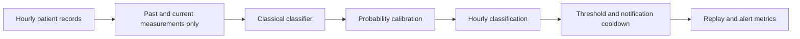

# Early sepsis warning across hospitals

A classical machine-learning pipeline (no deep learning) for hourly early warning of
sepsis in intensive care, built on the public PhysioNet 2019 challenge data. It
covers data checks, causal features, hyperparameter search, model selection,
probability calibration, an alert policy, a scoring API, drift monitoring and an
AWS deployment design. Course project for 61.501 Production Ready ML (theme: AI
for Social Good), Team 2. The question is: **can an hourly early-warning model
retain useful performance at another hospital under a limited notification budget?**

**Status of the results.** Every command runs end to end on an explicitly
synthetic software fixture. Synthetic scores demonstrate software behaviour only.
On the real data this repository holds the SIRS baseline results and the
hospital A against B comparison (both below). The trained model was run on the real
data on AWS (tune, train, approve, frozen evaluation); its results are in
[reports/final/report.md](reports/final/report.md), section 7, and in the MLflow runs of that
deployment. The commands under
[Tune, evaluate and write the report](#tune-evaluate-and-write-the-report) recreate them locally.

Start here:

- [Run the synthetic demo](#run-the-synthetic-demo): five commands, no data needed.
- [Use real PhysioNet data](#use-real-physionet-data): download, prepare, split, baseline.
- [Tune, evaluate and write the report](#tune-evaluate-and-write-the-report): the results tables and figures, each with its recreate command.
- [Run tracking and the research API](#run-tracking-and-the-research-api-l01-l02): MLflow, the registry and the scoring service.
- Who did what: [contributions.md](contributions.md). Code map: [docs/agent-repository-guide.md](docs/agent-repository-guide.md).

## System sketch



Input: one PhysioNet `.psv` file per patient, containing hourly vitals, laboratory
measurements and demographics. Output: a probability at every hour, an hourly
binary decision, and a separate notification event when the cooldown permits it.
An alert is a research output, not a diagnosis or treatment recommendation.

**Target semantics matter:** `SepsisLabel` becomes positive six hours before the
dataset-defined onset and stays positive afterward. We preserve this target
without shifting it again. The score estimates the probability of the challenge
label, not a validated probability of a first sepsis onset in the next six hours.
The inferred onset used for lead time is first-positive-label hour plus six;
records positive from their first row are excluded from our lead-time analysis.

## Run the synthetic demo

Use Python 3.12 or newer. The pinned `requirements.txt` is tested on 3.12 and 3.14.

```bash
python3 -m venv .venv
source .venv/bin/activate
python -m pip install -e .
python -m sepsis_warning demo
python -m unittest discover -s tests -v
```

Open `artifacts/demo/replay.html` in a browser. Select a validation patient,
play the hourly sequence, and inspect probabilities, threshold crossings,
notifications, and retrospective positive labels. The demo writes a model
comparison, a saved model with its manifest and that replay of validation stays.
Tests that need an optional extra that is not installed are skipped, not failed.

`train` and `demo` never score the test splits. Once a model is reviewed and
frozen, score internal test and hospital B one time:

```bash
python -m sepsis_warning evaluate --data data/synthetic \
  --model artifacts/demo/model.joblib --output artifacts/demo-evaluation
```

For real data this works once per model (a registered version is tagged, a
local bundle gets `frozen_evaluation.json` beside it) and only with the split
the model was trained on. Synthetic fixtures may be re-evaluated.

The default fixture has 160 hospital-A patients and 80 hospital-B patients. It
uses an artificial 20% patient prevalence and simplified trends, with a modest
measurement shift at B. It is intentionally easy and must not be used to claim
clinical accuracy, realistic domain adaptation, or real hospital performance.

Demo generation and experiment outputs require empty destinations. To repeat:

```bash
python -m sepsis_warning demo --data data/demo2 --output artifacts/demo2 --seed 43
```

## Test the whole pipeline locally (macOS or Linux)

Train, select, register, review, serve and call the model on synthetic data,
then run the production-like stack. Needs Python 3.12+ (`brew install
python@3.12` on a Mac) and, for steps 8-9, Docker Desktop.

```bash
# 1. Set up
git clone https://github.com/low1408/SUTD-PML-team2.git && cd SUTD-PML-team2
python3.12 -m venv .venv && source .venv/bin/activate
python -m pip install --upgrade pip
python -m pip install -e ".[serve,test,tracking]"

# 2. Tests (about 6 minutes; add the aws and checks extras to run the tests that are otherwise skipped)
MPLBACKEND=Agg python -m unittest discover -s tests

# 3. Train every candidate, select one on validation, register it as @candidate
python -m sepsis_warning demo --output artifacts/demo \
  --mlflow-uri sqlite:///artifacts/mlflow.db --register-model
open artifacts/demo/replay.html                   # xdg-open on Linux

# 4. Look at the selection: one parent run, one nested run per candidate (second terminal)
mlflow ui --backend-store-uri sqlite:///artifacts/mlflow.db --port 5001   # http://127.0.0.1:5001

# 5. Review, then promote the selected version to @production
python -m sepsis_warning promote --version 1 --reviewed-by "Your Name"

# 6. Serve the production model (checks its SHA-256 first); leave it running
python -m sepsis_warning serve --model-uri models:/sepsis-warning@production
```

In another terminal (with `source .venv/bin/activate`):

```bash
# 7. Call the prediction API
curl -s localhost:8000/health
curl -s localhost:8000/model                      # selected model, why, all candidates (validation only)
curl -s localhost:8000/score -H 'content-type: application/json' \
  -d '{"patient_id": "bed-1", "hours": [{"ICULOS": 1, "HR": 92}, {"ICULOS": 2, "HR": 118, "Temp": 38.9}]}'
curl -s localhost:8000/predict -H 'content-type: application/json' \
  -d '{"stays": [{"patient_id": "bed-1", "hours": [{"ICULOS": 1, "HR": 92}, {"ICULOS": 2, "HR": 118, "Temp": 38.9}]},
                 {"patient_id": "bed-2", "hours": [{"ICULOS": 1, "HR": 75}]}]}'
open http://127.0.0.1:8000/docs                   # interactive API docs
python scripts/latency.py --url http://127.0.0.1:8000 --output artifacts/latency.json
python -m sepsis_warning ward --api-url http://127.0.0.1:8000 --data data/synthetic \
  --output artifacts/ward/ward-api.html && open artifacts/ward/ward-api.html
```

Stop the server (Ctrl+C), then run the production-like stack: a load balancer,
two Fargate-sized tasks on a private network and the `@production` model
([docs/local-production.md](docs/local-production.md)).

```bash
# 8. Start it and run the production checks
bash scripts/local_prod.sh up                     # http://127.0.0.1:8080
bash scripts/local_prod.sh test

# 9. Release a second version with a rolling update, then roll back
python -m sepsis_warning train --data data/synthetic --output artifacts/run-002 --seed 43 \
  --mlflow-uri sqlite:///artifacts/mlflow.db --register-model
python -m sepsis_warning promote --version 2 --reviewed-by "Your Name"
bash scripts/local_prod.sh deploy models:/sepsis-warning@production
bash scripts/local_prod.sh deploy models:/sepsis-warning/1
bash scripts/local_prod.sh down
```

Notes:

- On an Apple Silicon Mac, `PLATFORM=linux/arm64 bash scripts/local_prod.sh up`
  is much faster; the default `linux/amd64` matches Fargate but runs emulated.
- `demo` needs an empty data folder; to train again on the same synthetic data
  use `train --data data/synthetic` with a new `--output`, as in step 9.
- To serve straight after training without the registry:
  `serve --model artifacts/demo/model.joblib` (`/model` still shows the selection).
- Start over: `rm -rf artifacts data/synthetic`.
- With real data, replace step 3 with the `train` command in
  [Run tracking and the research API](#run-tracking-and-the-research-api-l01-l02).
  Keep real data and models out of Git.

## Use real PhysioNet data

Source: [PhysioNet Challenge 2019](https://physionet.org/content/challenge-2019/1.0.0/).
Two public training cohorts contain 20,336 and 20,000 patients. Use the current
[training directory](https://physionet.org/files/challenge-2019/1.0.0/training/)
rather than the older archive link on the challenge page, which may be broken.
Follow the dataset's CC BY 4.0 terms and attribution requirements.

```text
data/physionet/
  training_setA/
    p000001.psv
    ...
  training_setB/
    p100001.psv
    ...
```

Full steps, from a clean checkout to the SIRS results:

```bash
python -m venv .venv
source .venv/bin/activate        # Windows PowerShell: .venv\Scripts\Activate.ps1
python -m pip install -r requirements.txt
python -m pip install -e .
python scripts/download_data.py --limit 0 --output data/physionet
python -m sepsis_warning prepare --data data/physionet --output data/physionet/combined.parquet
python -m sepsis_warning split --data data/physionet/combined.parquet --output data/physionet/splits.csv
python -m sepsis_warning baseline --data data/physionet/combined.parquet --output artifacts/baseline
```

To train the models. `--data` takes the prepared Parquet file, which uses the
saved `splits.csv` and runs the data checks first (`pip install -e ".[checks]"`),
or the `.psv` folder, which is re-split with `--seed` into the same stays:

```bash
python -m sepsis_warning train --data data/physionet/combined.parquet --output artifacts/real
```

The full sequence with hyperparameter search, the results tables and the test
evaluation is under [Tune, evaluate and write the report](#tune-evaluate-and-write-the-report).

Check `split` against the stay counts in [Patient split](#patient-split). For the
notebook, also run `python -m pip install -e ".[notebook]"`.

Hardware used for the reported results, and how long each step took:

| Item | Value |
|---|---|
| Machine | Windows 11 laptop, Intel Core i9-14900HX (24 cores), 32 GB RAM |
| GPU | Present but not used; no code here needs one |
| Disk | 323 MB raw files on this machine, 19 MB Parquet |
| `prepare` | About 4.5 minutes |
| `split` | About 30 seconds |
| `baseline` | About 4 to 5.5 minutes |
| `sirs-failures` | About 1.5 minutes |
| Download and full `train` | Not timed |

Seeds: the split and the models use `--seed 42`.

`--limit 500` downloads a sample instead of all records. A small random subset may
have too few sepsis patients for reliable splitting; increase the sample if the
CLI reports that.
Full feature tables are currently built in memory and may consume several GB.
Start with a subset; add partitioned feature caching before a full-cohort study.
Raw data and generated artifacts are excluded by `.gitignore`.

## SIRS baseline (the score every model must beat)

```bash
python -m sepsis_warning baseline --data data/physionet/combined.parquet --output artifacts/baseline
```

Writes `artifacts/baseline/baseline_metrics.csv`: one row per baseline per
split (`validation`, `internal_test`, `external_test` = hospital B). With a
Parquet `--data`, `baseline` uses the saved `splits.csv` next to it (or
`--splits <path>`). A folder of `.psv` files as `--data` still works: it reads
every record and re-splits with `--seed`, which gives the same stays as `train`,
so model rows can be added to the same table later.

| Baseline | Rule |
|---|---|
| `sirs` | Alert hour when **≥ 2** of: Temp > 38 or < 36 °C; HR > 90; Resp > 20 or PaCO2 < 32 mmHg; WBC > 12 or < 4 ×10⁹/L. |
| `always_no` | Never alerts. Shows the score of doing nothing. |

- **Causal.** Each hour uses the last value seen at or before that hour (forward
  fill only). Future hours never change earlier scores.
- **Missing = normal.** A variable never observed does not count as abnormal.
- Band neutrophils (part of the clinical WBC criterion) are not in the dataset.
- Neither baseline is trained, so they use no training data.
- Alerts go through the same `policy.apply_policy` (6 h cooldown) and
  `policy.summarize` as the models. Precision, recall, F1, AUROC and AP are
  hourly and hand-written in `baselines.py` (no sklearn metrics; tests check
  them against sklearn). For `always_no`, precision is undefined (blank).
- `probability` for SIRS is criteria met ÷ 4, so the ranking metrics (AP, AUROC)
  are meaningful but it is not a calibrated probability.

**What this baseline is and is not.** It is a transparent research comparator
for the benchmark label. It does **not** diagnose sepsis, and it is not full
clinical SIRS:

- Band neutrophils (> 10% bands) are not recorded, so the white-cell criterion
  uses WBC only.
- PaCO2 is only available when a blood gas was taken (91% of A hours and 98% of
  B hours have none), so the breathing criterion mostly relies on Resp.
- Old values are carried forward without a time limit. A WBC measured a day
  ago still counts now.
- Clinical SIRS also assumes a suspected infection. The rule here is applied to
  every ICU hour.

**Results on the full data** (seed 42; `artifacts/baseline/baseline_metrics.csv`):

| Split | Precision | Recall | F1 | Specificity | Accuracy | Utility | False alerts / non-septic day |
|---|---|---|---|---|---|---|---|
| Validation (A) | 0.033 | 0.536 | 0.063 | 0.655 | 0.652 | 0.084 | 1.98 |
| Internal test (A) | 0.033 | 0.529 | 0.063 | 0.661 | 0.658 | 0.087 | 1.97 |
| External test (B) | 0.028 | 0.511 | 0.052 | 0.742 | 0.739 | −0.014 | 1.52 |
| Always-no (validation) | 0 (nothing flagged) | 0 | 0 | 1.000 | **0.978** | 0 | 0 |

Metrics follow the course's confusion-matrix definitions (L9), hand-written in
NumPy: precision TP/(TP+FP), recall TP/(TP+FN), specificity TN/(TN+FP),
F1 2TP/(2TP+FP+FN), accuracy (TP+TN)/all. Accuracy is reported because the
brief asks for it, but it is misleading here: always-no is 97.8% "accurate"
while catching no sepsis at all. When nothing is flagged, precision is 0/0; it
is reported as 0 and marked in `no_predicted_positives`.

**Threshold trade-off (validation only).** The same command also scores SIRS
at ≥ 1, 2, 3 and 4 criteria on the validation split
(`artifacts/baseline/sirs_threshold_sweep_validation.csv`,
`reports/figures/08_sirs_threshold_tradeoff.png`). Raising the threshold gives
fewer false alarms but misses more sepsis (course L4). Only ≥ 4 stays under the
0.2 false-alerts-per-day budget, and it then catches just 3% of septic hours.
This is descriptive: the rule stays at the standard ≥ 2 and the test splits are
not used to look at thresholds.

| Alert at | Precision | Recall | F1 | Specificity | False alerts / day |
|---|---|---|---|---|---|
| ≥ 1 | 0.025 | 0.823 | 0.049 | 0.293 | 3.43 |
| **≥ 2 (rule)** | 0.033 | 0.536 | 0.063 | 0.655 | 1.98 |
| ≥ 3 | 0.044 | 0.220 | 0.074 | 0.895 | 0.70 |
| ≥ 4 | 0.056 | 0.033 | 0.042 | 0.988 | 0.10 |

Group-level patterns of where SIRS fails (validation split only) are in
[docs/sirs-failure-patterns.md](docs/sirs-failure-patterns.md).

`baseline` also redraws `reports/figures/08_sirs_threshold_tradeoff.png`. Pass
`--figures <folder>` to write it somewhere else.

## Patient split

```bash
python -m sepsis_warning split --data data/physionet/combined.parquet --output data/physionet/splits.csv
```

Writes `splits.csv` (`patient_id`, `hospital`, `septic`, `split`) and
`splits.csv.summary.json` (seed, SHA-256 of the Parquet input and of the CSV,
counts). Both stay in the git-ignored `data/` folder.

| Split | Source | ICU stays | Septic stays |
|---|---|---|---|
| train | 55% of A | 11,183 | 984 |
| calibration | 15% of A | 3,051 | 269 |
| validation | 15% of A | 3,051 | 268 |
| internal_test | 15% of A | 3,051 | 269 |
| external_test | all of B | 20,000 | 1,142 |

- Stratified by "ever septic", so each A split has the same 8.8% septic share.
- The split depends only on the seed. Records are sorted by ID before
  splitting, so the load order (folder or Parquet) cannot change it.
- **The unit is an ICU stay, not a person.** The data has no person ID, so one
  person could have stays in two different splits.

Code: [src/sepsis_warning/baselines.py](src/sepsis_warning/baselines.py).
Tests: [tests/test_baselines.py](tests/test_baselines.py).

## Data checks and versioning

These are optional installs, so nothing else depends on them.

```bash
python -m pip install -e ".[checks]"
python -m sepsis_warning validate
```

`validate` checks every stay against the written hard rules in
`src/sepsis_warning/schema.py`: required columns, numeric types, no infinite
values, labels that are 0 or 1 and never drop back to 0, and consecutive hours.
Blank clinical values are allowed. It also counts readings outside broad review
limits on the training stays only. Those limits are this project's own, and they
never reject data. Reports show counts only, and small counts appear as `<10`.

DVC records which data files belong with this code: see
[docs/data-versioning.md](docs/data-versioning.md).

## What is implemented

| Component | Implementation |
|---|---|
| Data checks | Required schema, binary nondecreasing labels, consecutive hours |
| Features | Last observed value, current missingness, never-observed flag, hours since observation, rolling mean/std/count, six-hour change |
| Baselines | SIRS rule (two or more of four criteria), never alerting, and a constant-prior model |
| Models | Logistic regression, random forest, histogram gradient boosting; optional hand-written NumPy versions of the three (`--include-numpy-models`) |
| Hyperparameters | Random or grid search with patient-grouped cross-validation on the training split only (`tune`) |
| Missing values | Forward fill within a patient; training-only median imputation for logistic regression and random forest |
| Calibration | Sigmoid calibration on a separate source-patient cohort |
| Alert selection | Threshold grid, fixed six-hour cooldown, validation alarm budget, one-standard-error model choice |
| Evaluation | Accuracy, precision, recall, F1, average precision, AUROC, Brier score, normalized hourly utility, alert count, early-detection recall, inferred warning lead time, with stay-grouped bootstrap intervals; test splits scored once (`evaluate`) |
| Explanation and bias audit | Grouped permutation importance of the selected model; results by recorded sex, age band and hospital with intervals (`model-report`) |
| Serving | FastAPI scoring service (`serve`), Docker images, a client with a SIRS fallback, and batch replay from a saved model; labels are not required |
| Tracking and release | MLflow runs and model registry, promotion gates against the baselines, bundle hashes checked before loading |
| Monitoring | Two-speed drift checks (fast: schema, missingness, input and score PSI, alert rate; slow: calibration, AUROC, utility, early recall, false alerts, subgroup gaps) with thresholds frozen from hospital A only |
| Reproducibility | Seed, versions, file hashes, patient split manifest, model and predictions; pinned and hash-locked requirements |

Source hospital A is split approximately 55% training, 15% calibration,
15% validation and 15% internal testing, stratified at patient level. Hospital B
is reserved for external testing. No patient-hour row split is used. ICU unit
administrative codes and patient/hospital IDs do not enter the model.

Fit preprocessing and model on training patients. Fit calibration on calibration
patients. Choose model and probability threshold on validation patients: the
simplest model whose validation utility is within one bootstrap standard error
of the best (candidates and settings in `src/sepsis_warning/models.toml`). Freeze
all choices, then run `evaluate` once for internal-test and hospital-B patients. Do not
adjust the threshold after inspecting B and still call B an untouched test.

The default validation budget is **0.2 false alert events per nonseptic
patient-day**. This is a demonstration choice, not a clinician-approved budget.
The denominator includes only patients whose complete record has no positive
labels. It does not count excessively early alerts in eventual sepsis patients;
the hourly utility separately penalizes those predictions. Exposure is the
observed hourly record length divided by 24, not a calendar-day count. The budget
may be exceeded at the held-out hospital. Report that degradation rather than
retuning on its labels.

Normalized utility follows the default published PhysioNet 2019 equations and
uses **hourly_positive**, not cooldown-suppressed **alert_event**. Cooldown
notifications are a separate operational metric. No positive patients means
the normalized utility is undefined and is reported as null. The prototype's
average precision is sklearn's metric, not a claim of official leaderboard AUPRC.

## Design and presentation

- [Run order](docs/RUN-ORDER.md): what to click in GitHub Actions, in which order, for a new environment or a new model. One page.
- [Design page](docs/design/sepsis-warning-pipeline.html): data split, training, model selection, alert policy, ICU call contract, AWS deployment and MLOps loop. Open it in a browser.
- [Final presentation](docs/presentation/sepsis-early-warning.pptx): 22 slides with speaker notes. Source, assets and rebuild steps are in [docs/presentation](docs/presentation/README.md).
- [Monitoring plan](docs/monitoring-plan.md) (M02): two-speed checks, reference data, thresholds, owners and runbook.
- [Risk register](docs/risk-register.md) (M05): leakage, data quality, source shift, privacy, fairness, alert fatigue, licensing and operational risks, with evidence and remaining exposure.
- [ICU ward replay](docs/ward-replay.md): plays stays hour by hour as a care team would see them; synthetic version in `docs/design/ward-replay-synthetic.html`.

## Two-speed monitoring (M02)

Freeze a monitoring reference from hospital A, then replay a held-out split
through it. The reference reads only A train (inputs) and A validation scored
by the frozen bundle (scores, alerts, performance); thresholds are the larger
of a fixed floor and the 95th/99th percentile on no-shift A-validation
windows. Nothing retrains automatically.

```bash
python -m sepsis_warning monitor-setup --data data/physionet --model artifacts/real/model.joblib \
  --output artifacts/monitoring/reference
python -m sepsis_warning monitor-replay --data data/physionet --model artifacts/real/model.joblib \
  --reference artifacts/monitoring/reference/monitoring_reference.json \
  --split external_test --output artifacts/monitoring/replay-b
```

Run the replay only after the model, features, calibration and alert policy
are frozen. The replay refuses a bundle whose SHA-256 differs from the
reference and writes aggregates only (`monitoring_report.md`, `summary.json`,
per-window CSVs, `monitoring_overview.png`). Fast (unlabeled) alarms are a
prompt to investigate, not proof of performance loss. The synthetic smoke run
and the meaning of every check are in [docs/monitoring-plan.md](docs/monitoring-plan.md).

## Run tracking and the research API (L01, L02)

Every `train` and `demo` run writes `run_metadata.json`: seed, feature-contract
hash, git commit and package versions. Pass the split summary so the split's
seed and hashes are logged too; a different seed is refused.

```bash
pip install -e ".[tracking]"
python -m sepsis_warning train --data data/physionet/combined.parquet --output artifacts/run-001 \
  --splits-summary data/physionet/splits.csv.summary.json \
  --mlflow-uri sqlite:///artifacts/mlflow.db --register-model
```

MLflow gets a selection run: the fingerprints and the selected model's
validation metrics, plus one nested run per candidate with its validation
metrics, settings, fit time and training-loss curve. Held-out test results,
predictions, manifests and replay reports are never logged. `--register-model`
also registers the selected bundle as a new version of `sepsis-warning` with the
`@candidate` alias; `promote` moves `@production` after a named review, and
`serve --model-uri models:/sepsis-warning@production` serves it after checking
its SHA-256. Use the SQLite store: MLflow 3 refuses the old `file:` store and the
registry needs a database. Details in [docs/mlflow.md](docs/mlflow.md). Add
`--dvc-lock dvc.lock` to record the data version.

```bash
pip install -e ".[serve]"
python -m sepsis_warning serve --model artifacts/demo/model.joblib   # 127.0.0.1:8000
python -m sepsis_warning serve --model-uri models:/sepsis-warning@production   # or from the registry
curl -s localhost:8000/health
curl -s localhost:8000/score -H 'content-type: application/json' \
  -d '{"patient_id": "demo-1", "hours": [{"ICULOS": 1, "HR": 92}, {"ICULOS": 2, "HR": 101, "Temp": 38.4}]}'
```

| Endpoint | Input | Output |
|---|---|---|
| `GET /health` | none | Status and the loaded bundle: model, hash, threshold, cooldown, feature count |
| `GET /model` | none | The selected model, the selection rule and every candidate's validation metrics, the training fingerprints, and the registry version and reviewer when served from the registry. Never held-out test results |
| `POST /score` | One stay's full history | A probability, threshold crossing and alert flag for every hour |
| `POST /predict` | Up to 64 stays (a ward), each with its full history | For each stay, its latest hour: probability, whether it is above the threshold, `new_alert` (true only in the hour an alert fires, so hourly polling notifies once) and the last alert hour |

Every scoring response names the `model_version` and `bundle_sha256` that
produced it, gives each prediction a stable `prediction_id` and a `risk_tier`
(low, watch, alert: a demonstration scale relative to the threshold), and lists
`input_warnings` for values outside the review range. Impossible values (for
example `HR` 9999, or a temperature in Fahrenheit) are rejected with 422, and a
request over 5 MB or 8,000 hours gets 413. `X-Request-Id` is echoed.

Options for `serve`:

- `--alert-ledger memory` or `--alert-table <DynamoDB table>` records the
  alerts that were raised, so the history shows what staff actually saw and a
  model change cannot re-alert inside the cooldown. Without it the cooldown is
  replayed from the request history.
- `--telemetry` prints one JSON line per request (latency, hours scored,
  alerts, errors) and per prediction (hashed stay ID, score, missing inputs;
  never a measurement value). `--prediction-log file.jsonl` writes the
  prediction lines to a file for `monitor-live`, which runs the label-free
  drift checks against a `monitor-setup` reference.

Client code should use `sepsis_warning.client.ScoringClient`: a 5-second
timeout, retries with jittered backoff on 429/5xx, a circuit breaker, optional
SigV4 signing, and `predict_or_fallback`, which returns SIRS rule results
marked `"fallback": true` when the service is unavailable.

Promotion is gated: `promote` refuses a model that does not beat the
no-model reference and the SIRS rule at the same alert budget, exceeds the
alert budget or is worse calibrated than the reference, and it records who
approved. See [docs/mlflow.md](docs/mlflow.md) and the
[audit and plan](docs/mlops-audit.md).

`/docs` serves interactive documentation. `serve` refuses to start if the run
folder's selection files describe a different model or threshold from the bundle.

Each request sends one stay's full history from its first ICU hour; the server
keeps no state between requests. Missing fields mean "not measured". Labels,
unit codes and hospital IDs are rejected (422). A bundle that does not fit the
current feature code is refused at start-up or with 409. There is no
authentication, so the command refuses non-local hosts unless
`--allow-non-local-host` is passed. Scores are research output, not clinical advice.

To test the AWS layout on a laptop (load balancer, two Fargate-sized tasks on
a private network, model from the registry's `@production` alias, rolling
deploy and rollback), see [docs/local-production.md](docs/local-production.md):

```bash
bash scripts/local_prod.sh up && bash scripts/local_prod.sh test
```

## Tune, evaluate and write the report

```bash
# 1. Hyperparameter search: patient-grouped cross-validation on the training split only, logged to MLflow.
python -m sepsis_warning tune --data data/physionet/combined.parquet --output artifacts/tuning \
  --trials 12 --folds 3 --mlflow-uri sqlite:///mlflow.db
# 2. Train with the tuned settings (validation picks the model and threshold; test is untouched).
python -m sepsis_warning train --data data/physionet/combined.parquet --output artifacts/real \
  --models-config artifacts/tuning/tuned_models.toml --include-numpy-models
# 3. One script for the results: metrics table, PR curves and the other figures.
python -m sepsis_warning model-report --run artifacts/real --output reports/results --tuning artifacts/tuning
```

`tune` never reads calibration, validation or test data; it writes `tuning_results.csv`, `tuning_best.json` and
`tuned_models.toml`, and logs one nested MLflow run per configuration to the `sepsis-warning-tuning` experiment.
`train` also writes `feature_importance.csv`: the drop in validation average precision when all columns built from
one measurement, or all columns of one kind, are shuffled together (about one to two minutes on the full data;
`--importance-repeats 0` skips it).

`model-report` fits nothing: it reads the files `train` wrote and writes, all with stay-grouped 95% intervals:

| Output | Content |
|---|---|
| `metrics_table.md/.csv` | Every candidate and the SIRS baseline on validation: accuracy, precision, recall, F1, average precision, AUROC, hourly utility, false alerts per non-septic patient-day |
| `subgroup_table.md/.csv` | Bias audit of the selected model by recorded sex and age band: counts, recall, precision, utility, alert burden and the largest gap; groups with fewer than 10 septic stays are counted but not scored |
| `feature_importance.md/.csv`, `fig_feature_importance.png` | The measurements and kinds of feature the selected model relies on |
| `fig_*.png`, `figures_manifest.json`, `FIGURES.md` | Precision-recall curves, model comparison, threshold trade-off, calibration, confusion matrices, loss curves, failure examples and the tuning search; each figure's recreate command is listed and printed on the image |
| `environment.json` | Python and package versions, platform and CPU count |

After the model is frozen and `evaluate` has run once, add `--evaluation <evaluate folder>`. That adds
`test_metrics_table.md/.csv` (the frozen model beside SIRS at the standard two criteria, SIRS at its validation
alert-budget threshold and never alerting, on the internal test and hospital B), `test_subgroup_table.md/.csv`
(sex and age band within each test split, then hospital A against hospital B) and `fig_test_pr.png`. No threshold
is tuned on the test splits. `fig_failure_examples.png` shows individual stays: check it before it leaves the
private folder. The report draft with the 11 required sections is `reports/final/report.md`.

## Deploy to AWS

The AWS design is deployed and has been run end to end on the real data. The default training backend is ECS Fargate
(Spot for the long steps), MLflow and Evidently run on ECS with a PostgreSQL database, and scoring runs on AWS Lambda behind an
IAM-authenticated HTTPS URL. Everything is started from GitHub Actions (no AWS keys are stored); a power workflow stops the
always-on tools so nothing bills while idle. The older SageMaker path is still in the code but is not used by any environment.

Where to start:

- **What to click, in order:** [docs/RUN-ORDER.md](docs/RUN-ORDER.md)
- **What each workflow and option does:** [docs/WORKFLOWS.md](docs/WORKFLOWS.md)
- **All the documents, by purpose:** [docs/README.md](docs/README.md)
- **Design diagram:** [docs/design/sepsis-warning-pipeline.html](docs/design/sepsis-warning-pipeline.html), section 6

From a shell the same steps are `bash scripts/aws_deploy.sh <stack|images|pipeline|promote|publish|serve|call>`; the workflows call
these commands.

Locally, the images can be built and checked without AWS:
`docker build --target lambda .`, `docker build --target training .`, and
`serve --model-s3 s3://.../model.joblib --model-sha256 <hash>` for a bundle
already in S3.

## Files and artifacts

The main modules (a code map with data contracts is in
[docs/agent-repository-guide.md](docs/agent-repository-guide.md)):

```text
src/sepsis_warning/
  data.py, prepare.py, splits.py, schema.py   # records, Parquet preparation, saved split, data checks
  features.py                                 # causal feature construction (shared by train and serve)
  baselines.py                                # SIRS rule and never-alert baselines
  modeling.py, models.toml                    # candidate models, settings and calibration
  logistic.py, random_forest.py, gradient_boosting.py, histogram_trees.py   # hand-written NumPy models
  tuning.py, tuning_space.toml                # patient-grouped hyperparameter search
  policy.py                                   # thresholds, notifications, utility, model selection
  importance.py                               # grouped permutation importance
  evaluation.py                               # one frozen evaluation of the test splits
  model_report.py                             # results tables and figures for the report
  scoring.py, service.py, api.py, client.py   # shared scorer, scoring service and its client
  tracking.py, registry.py, gates.py          # MLflow runs, model registry, promotion gates
  monitoring.py, live_drift.py                # two-speed drift monitoring (M02)
  cli.py                                      # every command
scripts/      # data download, latency test, AWS deployment helpers
tests/        # unit, contract, leakage and parity tests on synthetic fixtures
infra/        # CloudFormation templates and the local production-like stack
docs/         # design, runbooks, monitoring plan, risk register, presentation
reports/      # committed figures, baseline results and the report draft
```

The experiment creates:

- `validation_models.csv`: model comparison using validation patients only.
- `validation_scores.csv`: every candidate's validation score for every hour,
  the SIRS score and the stay's recorded age and gender. `model-report` reads
  it. Stay-level, so it stays in the git-ignored run folder.
- `feature_importance.csv`: grouped permutation importance of the selected
  model on validation (aggregates only).
- `candidate_details.json`, `calibration.json`: each candidate's settings, fit
  time and loss curve; calibration before and after Platt scaling.
- `metrics.json` / `selection_metrics.json`: validation results, the selection
  rule and which models were within one standard error. No test results.
- `split_manifest.csv`: patient-to-split mapping and raw record SHA256 hashes.
- `config.json`: feature names, seed, package versions, model settings and operating settings.
- `model.joblib`: saved calibrated classifier, features, threshold, cooldown and its manifest.
- `manifest.json`: package versions, feature-code and data hashes, validation
  metrics and the bundle's SHA-256. `serve` and `load_bundle` verify the bundle
  against it, and a bundle fitted under another scikit-learn minor is refused.
- `extreme_value_review_train.csv`: review-flag counts from the data checks (Parquet input).
- `validation_predictions.csv`, `replay.html`: hourly scores and an interactive
  replay for validation stays only.

`evaluate` creates `evaluation_metrics.json`, `held_out_predictions.csv` (the
model's scores, the SIRS score and the stay's recorded age and gender for
every test hour; stay-level, keep private) and a `replay.html` for the test
splits.

Training on `combined.parquet` first runs the schema checks (`pip install -e
".[checks]"`); a dropped label or a skipped hour stops the run before fitting.
`--include-numpy-models` adds the hand-written NumPy models as candidates.

Batch inference from a saved local model:

```bash
python -m sepsis_warning replay \
  --model artifacts/demo/model.joblib \
  --patient data/synthetic/training_setB/synthetic_0000.psv \
  --output artifacts/patient_replay.csv
```

This computes patient-local feature histories in batch. The prefix-invariance
tests check that scoring an earlier hour does not change when later measurements
are appended. The implementation is not yet an incremental streaming service.

## Work remaining for the course project

The code for tuning, intervals, plots, the subgroup audit, the API and the
latency test is in place. What is still open:

1. Run the real-data experiment end to end (`tune`, `train`, `model-report`),
   freeze the model, run `evaluate` once, and commit the aggregate results to
   `reports/results/`. Only the SIRS baseline has real-data numbers in the
   repository today. Treat dataset cohorts as the public hospital sources, not
   as identifiable hospitals.
2. Fill in the report draft (`reports/final/report.md`) and export it to PDF.
3. A separately prespecified B-to-A study has no code yet.
4. A budget-versus-early-recall curve is not drawn; the report has the
   threshold trade-off of the selected model instead.
5. Explanations stop at grouped permutation importance. SHAP (M03) is not
   started, and there is no written model card document yet (M04).
6. Compare missingness features on and off with the shared feature builder.
   The `missingness` command is exploratory and builds its own features.
7. Examine very early alarms and measurement outages. Document censored onset
   assumptions and post-onset rows in the challenge task.
8. Full feature tables are built in memory; there is no feature cache.
9. The AWS design is deployed for one environment (dev) only; staging and prod have parameters but have not been run (see [Deploy to AWS](#deploy-to-aws)).

Task owners and status are in [TEAM-TASKS.md](TEAM-TASKS.md); the summary of who
did what is in [contributions.md](contributions.md).

## Sources

- Reyna et al., [Early Prediction of Sepsis, PhysioNet 2019](https://physionet.org/content/challenge-2019/1.0.0/).
- [Official challenge scoring implementation](https://github.com/physionetchallenges/evaluation-2019).
- [Scikit-learn calibration documentation](https://scikit-learn.org/stable/modules/calibration.html).
