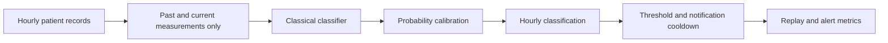

# Early sepsis warning across hospitals

Rough project sketch and runnable classical-ML scaffold for the selected proposal.
The question is: **can an hourly early-warning model retain useful performance
at another hospital under a limited notification budget?**

The first version runs with an explicitly synthetic software fixture. It produces
a model comparison, saved model, held-out predictions, and an offline patient
replay. Synthetic scores demonstrate software behavior only. Real-data model
quality has not been established.

## System sketch



Input: one PhysioNet `.psv` file per patient, containing hourly vitals, laboratory
measurements and demographics. Output: a probability at every hour, an hourly
binary decision, and a separate notification event when the cooldown permits it.
An alert is a research output, not a diagnosis or treatment recommendation.

**Target semantics matter:** `SepsisLabel` becomes positive six hours before the
dataset-defined onset and stays positive afterward. We preserve this target
without shifting it again. The score estimates the probability of the challenge
label, not a validated probability of a first sepsis onset in the next six hours.
The inferred onset used for lead time is first-positive-label hour plus six;
records positive from their first row are excluded from our lead-time analysis.

## Run the synthetic demo

Use Python 3.11-3.13 with compatible package wheels.

```bash
python3 -m venv .venv
source .venv/bin/activate
python -m pip install -e .
python -m sepsis_warning demo
python -m unittest discover -s tests -v
```

Open `artifacts/demo/replay.html` in a browser. Select an internal-test or
external-test patient, play the hourly sequence, and inspect probabilities,
threshold crossings, notifications, and retrospective positive labels.

The default fixture has 160 hospital-A patients and 80 hospital-B patients. It
uses an artificial 20% patient prevalence and simplified trends, with a modest
measurement shift at B. It is intentionally easy and must not be used to claim
clinical accuracy, realistic domain adaptation, or real hospital performance.

Demo generation and experiment outputs require empty destinations. To repeat:

```bash
python -m sepsis_warning demo --data data/demo2 --output artifacts/demo2 --seed 43
```

The Codex workspace currently has an already-installed `.venv`; the commands
above are the portable setup for teammates.

## Use real PhysioNet data

Source: [PhysioNet Challenge 2019](https://physionet.org/content/challenge-2019/1.0.0/).
Two public training cohorts contain 20,336 and 20,000 patients. Use the current
[training directory](https://physionet.org/files/challenge-2019/1.0.0/training/)
rather than the older archive link on the challenge page, which may be broken.
Follow the dataset's CC BY 4.0 terms and attribution requirements.

```text
data/physionet/
  training_setA/
    p000001.psv
    ...
  training_setB/
    p100001.psv
    ...
```

A downloader is provided but is not automatically run by the demo:

```bash
python scripts/download_data.py --limit 500 --output data/physionet
python -m sepsis_warning train --data data/physionet --output artifacts/real
```

`--limit 0` downloads all records. A small random subset may have too few sepsis
patients for reliable splitting; increase the sample if the CLI reports that.
Full feature tables are currently built in memory and may consume several GB.
Start with a subset; add partitioned feature caching before a full-cohort study.
Raw data and generated artifacts are excluded by `.gitignore`.

## What is implemented

| Component | First implementation |
|---|---|
| Data checks | Required schema, binary nondecreasing labels, consecutive hours |
| Features | Last observed value, current missingness, never-observed flag, hours since observation, rolling mean/std/count, six-hour change |
| Models | Constant-prior baseline, logistic regression, random forest, histogram gradient boosting |
| Missing values | Forward fill within a patient; training-only median imputation for logistic regression and random forest |
| Calibration | Sigmoid calibration on a separate source-patient cohort |
| Alert selection | Threshold grid, fixed six-hour cooldown, validation alarm budget |
| Evaluation | Average precision, AUROC, Brier score, normalized hourly utility, alert count, early-detection recall, inferred warning lead time |
| Serving sketch | Batch replay from a saved model; labels are not required |
| Reproducibility | Seed, versions, file hashes, patient split manifest, model and predictions |

Source hospital A is split approximately 55% training, 15% calibration,
15% validation and 15% internal testing, stratified at patient level. Hospital B
is reserved for external testing. No patient-hour row split is used. ICU unit
administrative codes and patient/hospital IDs do not enter the model.

Fit preprocessing and model on training patients. Fit calibration on calibration
patients. Choose model and probability threshold on validation patients. Freeze
all choices before evaluating internal-test and hospital-B patients. Do not
adjust the threshold after inspecting B and still call B an untouched test.

The default validation budget is **0.2 false alert events per nonseptic
patient-day**. This is a demonstration choice, not a clinician-approved budget.
The denominator includes only patients whose complete record has no positive
labels. It does not count excessively early alerts in eventual sepsis patients;
the hourly utility separately penalizes those predictions. Exposure is the
observed hourly record length divided by 24, not a calendar-day count. The budget
may be exceeded at the held-out hospital. Report that degradation rather than
retuning on its labels.

Normalized utility follows the default published PhysioNet 2019 equations and
uses **hourly_positive**, not cooldown-suppressed **alert_event**. Cooldown
notifications are a separate operational metric. No positive patients means
the normalized utility is undefined and is reported as null. The prototype's
average precision is sklearn's metric, not a claim of official leaderboard AUPRC.

## Files and artifacts

```text
src/sepsis_warning/
  data.py             # patient schema, splits, synthetic fixture
  features.py         # causal feature construction
  modeling.py         # classical models and calibration
  policy.py           # thresholds, notifications, metrics
  cli.py              # training and replay commands
  report.py           # offline report generation
  report_template.html
scripts/download_data.py
tests/test_invariants.py
```

The experiment creates:

- `validation_models.csv`: model comparison using validation patients only.
- `metrics.json`: validation results and selected model's held-out results.
- `split_manifest.csv`: patient-to-split mapping and raw record SHA256 hashes.
- `config.json`: feature names, seed, package versions, and operating settings.
- `model.joblib`: saved calibrated classifier, features, threshold, cooldown.
- `held_out_predictions.csv`: hourly outcomes, scores, decisions and notifications.
- `replay.html`: self-contained interactive replay of held-out predictions.

Batch inference from a saved local model:

```bash
python -m sepsis_warning replay \
  --model artifacts/demo/model.joblib \
  --patient data/synthetic/training_setB/synthetic_0000.psv \
  --output artifacts/patient_replay.csv
```

This computes patient-local feature histories in batch. The prefix-invariance
tests check that scoring an earlier hour does not change when later measurements
are appended. The implementation is not yet an incremental streaming service.

## Work remaining for the course project

1. Run full real-data experiments, including A-to-B and a separately prespecified
   B-to-A study. Treat dataset cohorts as the public hospital sources, not as
   identifiable hospitals.
2. Perform patient-grouped hyperparameter tuning within source training data.
   Current estimator settings are starting values, not a completed search.
3. Add patient-bootstrap confidence intervals, calibration plots, precision-recall
   plots, and a budget-versus-early-recall curve.
4. Audit performance by age and recorded gender, with subgroup sample sizes.
   Compare missingness features on/off to test sensitivity to care practices.
5. Examine false alarms, missed cases, very early alarms, and measurement outages.
   Document censored onset assumptions and post-onset rows in the challenge task.
6. Add feature caching for the complete dataset and a lightweight API if needed.
   Monitor input missingness, calibration, cohort shift, alert volume, and latency.

Suggested team split: data/splits; features/models; calibration/alert policy;
evaluation/bias audit; replay/reproducibility/report integration. Each person
should also review another person's component.

## Sources

- Reyna et al., [Early Prediction of Sepsis, PhysioNet 2019](https://physionet.org/content/challenge-2019/1.0.0/).
- [Official challenge scoring implementation](https://github.com/physionetchallenges/evaluation-2019).
- [Scikit-learn calibration documentation](https://scikit-learn.org/stable/modules/calibration.html).
