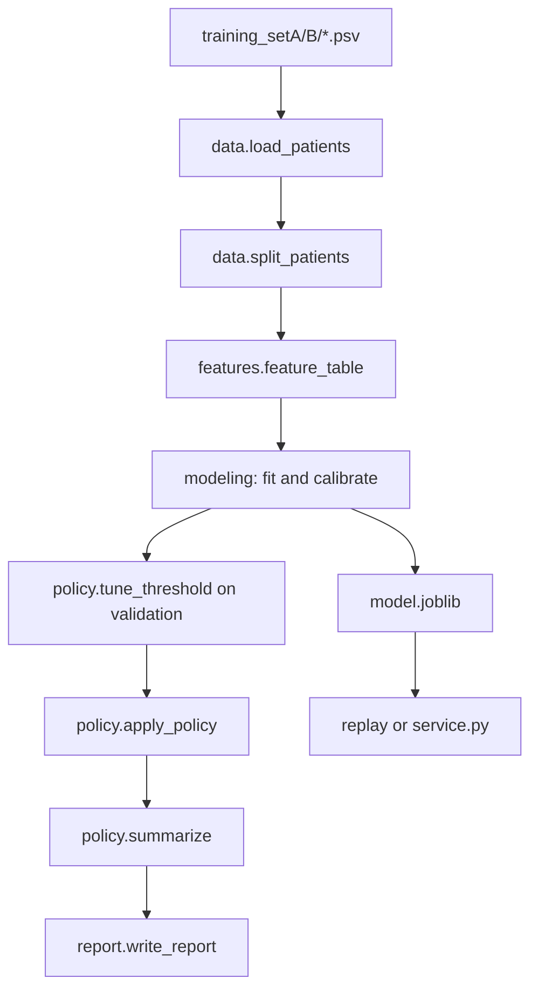

# Agent Repository Guide

This document is a code map for agents working in this repository. It describes
the implemented research scaffold as it exists in the source tree; the README
and task documents remain the authority for project results, ownership, and
research plans.

## Repository purpose

The project studies hourly early warning for the PhysioNet Challenge 2019
sepsis label. It compares classical models and transparent baselines across a
source cohort (hospital A) and a held-out external cohort (hospital B). The
software can generate a synthetic fixture, prepare and validate records, train
models, replay a saved model, produce offline monitoring reports, and expose a
local research scoring API.

This is not a clinical system. The challenge label is already shifted six hours
before the dataset-defined onset, so code must not shift `SepsisLabel` again.
Scores are retrospective research outputs and must not be described as a
diagnosis, treatment recommendation, or clinically validated risk estimate.

## Start here

Read these files in this order when investigating a change:

1. [README.md](../README.md): supported workflows, data semantics, reported
   results, limitations, and artifact descriptions.
2. [Agent.md](../Agent.md): repository guardrails and definition of done.
3. [src/sepsis_warning/cli.py](../src/sepsis_warning/cli.py): command routing and
   the training/evaluation orchestration.
4. The owning module listed below, then its neighboring tests.

The package uses a `src/` layout. Run commands from the repository root after
installing the editable package. The canonical package name is
`sepsis_warning`; the distribution and console script names are
`sepsis-warning-sketch` and `sepsis-warning`.

## Code map

| Module | Responsibility | Main entry points |
|---|---|---|
| `data.py` | PhysioNet PSV schema, patient objects, synthetic records, and patient-level splits | `read_patient`, `load_patients`, `split_patients`, `generate_synthetic` |
| `schema.py` | Combined-Parquet hard validation and non-rejecting extreme-value review | `validate_hourly`, `extreme_value_counts` |
| `prepare.py` | Validate PSV records and combine them into Parquet with provenance | `prepare_parquet` |
| `features.py` | Causal, patient-local feature construction and training-only fallback helpers | `build_features`, `feature_table`, `features_for_windows` |
| `modeling.py` | Candidate estimators and separate calibration fit | `candidate_models`, `fit_calibrated` |
| `policy.py` | Threshold decisions, cooldown notifications, utility, and evaluation metrics | `apply_policy`, `summarize`, `tune_threshold` |
| `baselines.py` | SIRS and always-no comparators plus threshold sweep | `baseline_table`, `sirs_threshold_sweep` |
| `scoring.py` | Load, hash-check, and batch-score a saved model bundle | `load_bundle`, `score_patients` |
| `service.py` / `api.py` | Stateless request validation and local HTTP scoring wrapper | `ScoringService`, `create_app` |
| `monitoring.py` | Frozen-reference fast and slow drift replay | `setup_monitoring`, `replay_monitoring` |
| `report.py` | Self-contained held-out patient replay HTML | `write_report` |
| `tracking.py` | Run metadata and optional local MLflow aggregate logging | `run_metadata`, `log_run` |
| `missingness.py` | Training/validation missingness audit and fixed-baseline comparison | `run_missingness_analysis` |
| `hospital_comparison.py` | Descriptive A/B cohort comparison and figures | `run_comparison` |
| `sirs_failures.py` | Validation-only aggregation of SIRS failure patterns | `failure_tables` |
| `splits.py` | Persist and reload Parquet split manifests and summaries | `write_splits`, `load_split_patients` |

`cli.py` is intentionally thin for most commands, but `run_experiment` is the
authoritative training flow. Keep production behavior in shared modules rather
than duplicating it in notebooks or scripts.

## End-to-end data flow



The `train` and `demo` commands do the following:

1. Refuse a non-empty output directory and detect synthetic versus real data.
2. Load one `Patient` per PSV file and split at stay level.
3. Build features only for train, calibration, and validation before model
   selection. Internal and external test rows are built later.
4. Fit each candidate on train and calibrate non-constant models on the
   separate calibration cohort.
5. Select the model and threshold on validation using hourly utility subject to
   the false-alert budget.
6. Freeze the selected bundle, score internal test and external test, apply the
   same threshold and cooldown, and write aggregate metrics plus replay files.

## Data and feature contracts

Each labeled PSV record needs the dynamic measurement columns in `data.py`,
the static columns `Age`, `Gender`, `HospAdmTime`, and `ICULOS`, plus a binary,
nondecreasing `SepsisLabel`. `ICULOS` must advance by one per row. API requests
omit `SepsisLabel`, hospital IDs, administrative unit codes, and patient IDs
from model inputs.

`build_features` is causal: at row t it uses only observations through t in the
same stay. Dynamic values are forward-filled within the stay with no expiry;
leading gaps remain missing for the model imputer. It also emits current
missingness, never-seen, hours-since-seen, rolling summary, and change/count
features. Static values are forward-filled. Do not replace these operations
with backward fill or a cross-patient fill.

The model input columns are every feature column except `META`:
`patient_id`, `hospital`, `hour`, and `label`. Metadata and labels must never
enter fitting or prediction features. Saved bundles carry the feature list and
window; scoring rejects a bundle that no longer matches the feature contract.

## Split and evaluation rules

- Sort IDs before splitting so folder order cannot affect results.
- Hospital A is stratified into approximately 55% train, 15% calibration, 15%
  validation, and 15% internal test.
- All hospital B stays are `external_test` and cannot guide model, threshold, or
  monitoring-reference selection.
- The split unit is an ICU stay, not a person; the dataset has no person ID.
- `hourly_positive` is the threshold decision at every hour.
- `alert_event` is the notification after the per-patient cooldown. Metrics and
  utility intentionally distinguish these two columns.
- Lead time is inferred from first positive label plus six hours. Stays positive
  on their first row are left-censored and excluded from lead-time eligibility.
- The validation default is `0.2` false alert events per nonseptic patient-day
  with a six-hour cooldown. This is an empirical research setting, not a
  guarantee on hospital B or a clinician-approved operating point.

## CLI command index

All commands are dispatched by `python -m sepsis_warning`:

| Command | Purpose | Typical input/output |
|---|---|---|
| `demo` | Generate a software-only fixture and train it | `data/synthetic` -> `artifacts/demo` |
| `prepare` | Validate PSV files and write combined Parquet | `data/physionet` -> `combined.parquet` |
| `split` | Persist the seed and patient split manifest | Parquet -> `splits.csv` and summary JSON |
| `validate` | Run hard checks and training-only review counts | Parquet + splits -> `artifacts/data_checks` |
| `baseline` | Score SIRS and always-no on all evaluation splits | Parquet or PSV root -> baseline CSV and figure |
| `train` | Fit, calibrate, select, evaluate, and write a bundle | PSV root -> experiment directory |
| `replay` | Score one unlabeled PSV history with a saved bundle | model + PSV -> CSV |
| `missingness` | Compare missingness patterns and fixed baselines | PSV root -> HTML/report artifacts |
| `compare-hospitals` | Produce descriptive A/B summaries and figures | Parquet + splits -> `reports/figures` |
| `sirs-failures` | Aggregate validation-only SIRS failure tables | Parquet or PSV root -> CSV tables |
| `monitor-setup` | Freeze monitoring reference from A train/validation | data + model -> reference JSON |
| `monitor-replay` | Replay a held-out split through that reference | data + model + reference -> aggregate report |
| `serve` | Run the unauthenticated local research API | model -> localhost server |

`prepare` refuses to overwrite an existing output. Training and demo also
require empty output directories. Choose a new artifact path rather than
deleting existing evidence.

## Tests and validation

The test suite uses `unittest` discovery. Run the focused module first, then the
full suite when shared behavior changes:

```powershell
python -m unittest tests.test_invariants -v
python -m unittest discover -s tests -v
```

The highest-value invariants are in
[tests/test_invariants.py](../tests/test_invariants.py): prefix invariance,
future-measurement corruption, no backward fill, training-only imputation,
patient-local fallback, split disjointness, cooldown reset, and utility
accounting. Other tests cover the API, schema, preparation, monitoring,
tracking, service, and SIRS failure reports. Use `MPLBACKEND=Agg` or the
Windows equivalent environment setting when running plotting tests in a
headless environment.

For a feature or policy change, add a focused regression test before changing
shared behavior. A passing synthetic test demonstrates software behavior only;
it is not evidence of real-cohort performance.

## Generated files and safety boundaries

Expected local-only locations are `data/` for raw/combined data and `artifacts/`
for models, predictions, manifests, reports, and monitoring outputs. Do not
commit patient-level data, model bundles, predictions, notebook outputs, or
credentials. Joblib bundles are executable deserialization inputs; only load
bundles produced by this repository or otherwise explicitly trusted.

When documenting or changing behavior, distinguish implemented code from the
planned work in the README and task tracker. Do not describe the API as
stateful streaming, the monitoring replay as live monitoring, or the synthetic
fixture as a physiological simulator.