# Whole-Codebase MLOps Audit & Production Transformation Report

Audited: `main` at `c4af079` (2026-11-15). `leo/aws-serverless-mlops` was
merged as PR #75, so `git diff main...leo/aws-serverless-mlops` is empty: the
serverless AWS work is now part of the baseline and is audited as such.

Scope read: all 35 modules in `src/sepsis_warning/` (6,066 lines), 23 test
files (248 tests), `Dockerfile`, 7 CloudFormation templates,
`.github/workflows/tests.yml`, the deploy and training scripts, and the two
notebooks. Line numbers refer to `c4af079`.

Two facts frame every finding:

- This is a **research system on a benchmark label** (PhysioNet 2019). It is not
  clinically validated, and the repo says so consistently.
- **Nothing has been deployed to AWS.** The infrastructure is linted, checked
  against the AWS documentation and exercised in local containers only.

---

## Section 1: Executive Summary & System Maturity Matrix

### Codebase overview

**What exists.** One Python package, `sepsis_warning`, used by every stage:

| Stage | Modules | Notes |
|---|---|---|
| Ingestion and validation | `prepare.py`, `data.py`, `schema.py`, `splits.py`, DVC (`dvc.yaml`) | PhysioNet `.psv` → `combined.parquet`; saved patient-level split; hospital B held out |
| Features | `features.py` | One causal builder, 34 measurements × 8 + 4 static = 276 features |
| Models | `modeling.py` (sklearn candidates), `logistic.py`, `histogram_trees.py`, `random_forest.py`, `gradient_boosting.py` (NumPy), `baselines.py` (SIRS), `hmm.py`, `signature.py` | NumPy, HMM and signature code is used by ablation scripts only |
| Selection and policy | `policy.py`, `cli.py:run_experiment` | Threshold tuned to an alert budget; 6-hour cooldown |
| Lineage | `tracking.py`, `registry.py`, `model_card.py`, `model_source.py` | MLflow (local SQLite or SageMaker MLflow App), `@candidate`/`@production`, S3 publish with SHA-256 |
| Serving | `service.py`, `api.py`, `lambda_app.py` | Stateless FastAPI; laptop, Fargate or Lambda |
| Consumers | `ward.py`, `report.py` | Static replay pages; no real client application |
| Monitoring | `monitoring.py` | Offline drift replay (PSI, calibration, subgroup gaps) |
| Cloud | `infra/cloudformation/*.yaml`, `scripts/aws_deploy.sh`, `scripts/sagemaker_train.py` | Lambda default, Fargate option, SageMaker training on spot, MLflow App |
| CI | `.github/workflows/tests.yml` | Unit tests, three image builds, smoke test, cfn-lint |

**How it connects.** `train` builds features, fits four candidates, calibrates,
tunes a threshold and selects on validation, writes `model.joblib`, logs to
MLflow and registers `@candidate`. A person runs `promote`, then `publish`
copies the bundle to S3, and a stack update pins its S3 URI and hash on the
Lambda function.

**What is missing for production.**

1. No automated promotion gate, and the reviewer is a self-typed name.
2. Held-out test sets are scored on every training run.
3. No serving telemetry: no structured logs, prediction log, custom metrics or live drift input.
4. No real consuming client; responses carry no `model_version` or `prediction_id`.
5. No CD: deploys are a manual script, with one environment and no canary or automatic rollback.
6. No pipeline orchestration or retraining trigger.
7. Dependencies are only partly locked.

### Maturity scorecard

| Pillar | Score | Evidence |
|---|---|---|
| 1. Data engineering, feature consistency, leakage | 🟡 MVP (strongest pillar) | **For:** one `build_features` for training and serving (`features.py:9-41`, `service.py:128-134`); 25 invariant tests including prefix and future-change tests (`tests/test_invariants.py:40-64,114`); imputer and scaler inside the fitted pipeline (`modeling.py:16-27`); patient-level split with hospital B external. **Against:** `train` never runs `validate_hourly` (`cli.py:309` is the only call); inference has no plausibility ranges (`data.py:40-59`); test splits scored every run (`cli.py:145-153`) |
| 2. Training, experimentation, lineage | 🟡 MVP | **For:** SageMaker training job separate from serving; MLflow nested runs; seed, split, feature and git hashes (`tracking.py`); registry aliases. **Against:** no metric gate (`registry.py:121-141`); fixed hyperparameters (`modeling.py:13-34`); bundle has no manifest (`cli.py:137-142`, `scoring.py:20`); no pipeline |
| 3. Serving and container architecture | 🟡 MVP | **For:** model loaded once per process or warm environment (`lambda_app.py:18-44`); hash-pinned load; multi-stage Dockerfile, non-root scoring image, allowlist `.dockerignore`; ~1.8 s cold start locally. **Against:** request limits exceed Lambda's (`service.py:36-37`); global predict lock (`service.py:59,136-140`); extras unpinned (`Dockerfile:51,62,70`) |
| 4. Consuming app integration, resilience | 🔴 Prototype | Only static replay pages. `ward.py:94-112` has a timeout but no retry, backoff, signing or fallback. Responses lack `model_version`, `prediction_id`, risk tier (`api.py:40-74`). Alert state is recomputed from history, so a model change rewrites past alerts |
| 5. IaC, security, IAM | 🟡 MVP | **For:** whole stack in CloudFormation; KMS, versioning, public access block, TLS-only bucket policy; scoped roles; IAM-authenticated URL. **Against:** never deployed; one environment; no Lambda version/alias; Fargate role can write an unused DynamoDB table (`service.yaml:113-119`); operator policy can overwrite `models/*` and read patient-level training output (`mlops.yaml:166-203`) |
| 6. CI/CD, testing, observability | 🟡 CI / 🔴 CD and telemetry | **For:** 248 tests, leakage and parity tests, image builds, cfn-lint on every PR. **Against:** no linter or type check in CI; no dependency or image scan; actions pinned by tag; no deploy pipeline; the service logs with `print` and emits no metrics; `monitoring.py` is offline only |

---

## Section 2: End-to-End Architecture Review

### Current architecture trace

```text
PhysioNet .psv ──prepare.py──▶ combined.parquet ──splits.py──▶ splits.csv (saved, hashed, DVC)
      │
      ▼  cli.py:run_experiment (laptop, or SageMaker job via sagemaker_train.py)
features.py:build_features ─▶ modeling.py (4 candidates, Platt calibration on its own split)
      ─▶ policy.py:tune_threshold (validation, 0.2 false alerts / non-septic patient-day)
      ─▶ select max utility ─▶ model.joblib {model, 276 columns, window, threshold, cooldown}
      ─▶ ALSO scores internal_test + hospital B every run  ⚠
      │
      ▼  tracking.py / registry.py
MLflow (SQLite or SageMaker MLflow App): parent + nested runs (validation only), @candidate
      │  human: promote --reviewed-by "<typed name>"  ⚠ no metric gate, no identity
      ▼
@production ──model_source.publish_model──▶ s3://bucket/models/vN/model.joblib (+sha256)
      │  human: aws_deploy.sh serve (CloudFormation update, all-at-once)  ⚠
      ▼
Lambda (function URL, IAM) or Fargate (internal ALB) ─ api.py ─ service.py ─ build_features ─ model ─ policy
      ▲                                                             │ no prediction log, no metrics  ⚠
      │ full stay history per request                               ▼
ward.py replay page / report.py (static HTML)  ⚠ no production client
```

### Target enterprise architecture

```mermaid
flowchart LR
  subgraph Source["Hospital / data plane"]
    EHR[Chart system or interface engine]
    RAW[(S3 raw, versioned)]
  end
  subgraph Train["Training account (Step Functions)"]
    VAL[Validate: schema + distribution contract]
    FE[Feature build: shared package wheel]
    TR[SageMaker training job, spot]
    EV[Evaluate: validation gates]
    REG[(MLflow App registry: candidate)]
    APPR{{Manual approval: IAM identity, 2 people}}
    FRZ[Frozen test evaluation: once per version]
  end
  subgraph Release["CD (GitHub Actions OIDC)"]
    ECR[(ECR, digest pinned)]
    S3M[(S3 models/vN, immutable)]
    CFN[CloudFormation change set: dev → staging → prod]
  end
  subgraph Serve["Serving account"]
    APIGW[API Gateway private + WAF + usage plan]
    L[Lambda alias live: canary 10% → 100%]
    DDB[(DynamoDB: alert ledger + idempotency)]
    FH[Firehose → S3 prediction log]
  end
  subgraph Observe["Observability"]
    CW[CloudWatch EMF metrics, alarms]
    DR[Scheduled drift job: monitoring.py]
    SNS[SNS / on-call]
  end
  EHR -->|signed HTTPS, retries, SIRS fallback| APIGW --> L
  L --> DDB
  L --> FH
  L --> CW
  RAW --> VAL --> FE --> TR --> EV --> REG --> APPR --> FRZ --> S3M
  S3M --> CFN --> L
  ECR --> CFN
  FH --> DR --> SNS
  CW --> SNS
  DR -->|drift or schedule| VAL
  CW -->|alarm during canary| CFN
```



| Component | Today | Target |
|---|---|---|
| Feature code | One module, imported by both paths ✅ | Same, built as a versioned wheel whose hash is recorded in the bundle |
| Training | Manual `aws_deploy.sh train` | Step Functions: validate → train → evaluate → register → approve → freeze-test → publish |
| Promotion | Typed reviewer name | Automated gates plus approval tied to an IAM identity; different person from the trainer |
| Model artifact | `model.joblib` dict, hash pinned | Bundle + `manifest.json` (versions, data and code hashes, metrics, signature); S3 Object Lock |
| Serving | Lambda function URL, `$LATEST`, env-var model pin | Lambda version + alias, CodeDeploy canary, alarm rollback; API Gateway private with WAF and throttling where a network-private path is required |
| Alert state | Recomputed from request history | DynamoDB alert ledger keyed by stay; cooldown read from the ledger; idempotent |
| Consumer | Replay page | Reference client: SigV4, timeouts, backoff with jitter, circuit breaker, SIRS fallback |
| Telemetry | `print` | Structured JSON logs, EMF metrics, prediction log to S3 (no raw vitals in logs), X-Ray |
| Drift | Offline replay | Scheduled job over the prediction log using `monitoring.py`; alarms open a review, never auto-promote |
| Environments | One stack | dev, staging, prod (separate accounts), promoted by pipeline |

---

## Section 3: Deep-Dive Codebase Findings

### Training & ML Core

**T1. Held-out test sets are scored on every training run**
- **Location:** `src/sepsis_warning/cli.py:L145-L153` (loop), `L158` (`held_out` in `metrics.json`), `L187-L189` (`held_out_predictions.csv`, `replay.html`).
- **Severity:** `[CRITICAL]`
- **Diagnosis:** Every `train` and `demo` run scores `internal_test` and hospital B and writes the results next to the model. Selection itself uses validation only (`L119-L133`), but anyone iterating on features or hyperparameters sees test results each time, so the reported test performance stops being an unbiased estimate. This contradicts the project's own freeze-before-test rule. The SageMaker job also ships these patient-level predictions in `model.tar.gz`.
- **Remediation:** Remove the loop from `run_experiment`. Add an `evaluate` command that takes a registered version, refuses a version already tagged `frozen_evaluated`, scores the test splits once, logs to a separate `sepsis-warning-evaluation` experiment and sets the tag.
  ```python
  def run_frozen_evaluation(model_uri, tracking_uri, data, splits):
      path, sha, tags = resolve_model(model_uri, tracking_uri)
      if tags.get("frozen_evaluated"):
          raise ValueError(f"version {tags['version']} was already evaluated on the test sets")
      ...  # score internal_test + external_test, log aggregates only
      client.set_model_version_tag(name, tags["version"], "frozen_evaluated", now)
  ```

**T2. Promotion has no metric gate and the reviewer is self-asserted**
- **Location:** `src/sepsis_warning/registry.py:L121-L141`; `scripts/aws_deploy.sh:L102-L105`.
- **Severity:** `[CRITICAL]`
- **Diagnosis:** `promote` only checks that `--reviewed-by` is not blank. Any holder of the operator policy can type any name and promote a model that is worse than the SIRS baseline, has a higher false-alert rate than the budget, or was trained on synthetic data. There is no separation between the person who trains and the person who approves.
- **Remediation:** Add `gates.py` and call it from `promote`; record the caller's identity from STS instead of a typed string; refuse when the approver equals the trainer.
  ```python
  GATES = {"normalized_hourly_utility": (">=", "baseline_sirs + 0.02"),
           "false_alert_events_per_nonseptic_patient_day": ("<=", 0.2),
           "brier_score": ("<=", "constant_prior"), "synthetic": ("==", False)}
  identity = boto3.client("sts").get_caller_identity()["Arn"]
  ```

**T3. The bundle carries no manifest**
- **Location:** `src/sepsis_warning/cli.py:L137-L142`; `src/sepsis_warning/scoring.py:L20,L33-L47`.
- **Severity:** `[HIGH]`
- **Diagnosis:** `model.joblib` is a pickled dict with seven keys. It does not record scikit-learn, NumPy or Python versions, the feature-code hash, the data or split hash, or its metrics. A pickle loaded under a different scikit-learn version can fail or, worse, score differently without an error. Lineage lives only in MLflow tags, which do not travel with the file. `load_bundle` also skips the hash check when no hash is given (`scoring.py:L36`).
- **Remediation:** Write `manifest.json` beside the bundle and embed the same dict under `bundle["manifest"]`: package versions, `feature_columns_sha256`, `features.py` source hash, split and data hashes, git commit, validation metrics, bundle format version. In `ScoringService.__init__`, refuse a bundle whose scikit-learn major.minor differs from the runtime. Make the hash mandatory outside tests.

**T4. `train` does not validate its input data**
- **Location:** `src/sepsis_warning/cli.py:L309` (only call of `validate_hourly`); `src/sepsis_warning/schema.py:L39-L70`.
- **Severity:** `[HIGH]`
- **Diagnosis:** The Pandera schema runs only in the separate `validate` command and needs the optional `checks` extra. A training job on corrupted or shifted data proceeds and registers a candidate.
- **Remediation:** Call `validate_hourly` at the start of `run_experiment` for Parquet inputs, fail the job on schema errors, and log `extreme_value_counts` as a run artifact. Add `checks` to the training image.

**T5. Hyperparameters are fixed in code and one seed decides selection**
- **Location:** `src/sepsis_warning/modeling.py:L13-L34`; `src/sepsis_warning/cli.py:L130-L133`.
- **Severity:** `[MEDIUM]`
- **Diagnosis:** No search, no cross-validation and no confidence interval. On the synthetic fixture three candidates differ by under 0.01 utility, so the winner is within noise.
- **Remediation:** Move settings to a versioned `configs/models.yaml`; add patient-grouped bootstrap intervals to `summarize`; select with a one-standard-error rule that prefers the simpler model.

**T6. Carry-forward has no expiry**
- **Location:** `src/sepsis_warning/features.py:L13,L28,L40`.
- **Severity:** `[MEDIUM]` (documented design choice with clinical weight)
- **Diagnosis:** A lab value from days ago is still `X__last`. `hours_since_seen` lets the model discount it, but tree models may not. This is a validity question for clinicians, not a code bug.
- **Remediation:** Keep the behaviour, add a per-measurement staleness limit as a config ablation, and get a clinical decision recorded in the model card.

**T7. Parallel model implementations that the pipeline does not use**
- **Location:** `src/sepsis_warning/logistic.py`, `histogram_trees.py`, `random_forest.py`, `gradient_boosting.py` (806 lines); used only by `scripts/h03_ablation.py:L35-L53`.
- **Severity:** `[MEDIUM]`
- **Diagnosis:** The NumPy models required by the course are not in `candidate_models`, so the registered model is always a scikit-learn one. Two implementations of the same algorithm will drift.
- **Remediation:** Register them as candidates behind a flag with a parity test against scikit-learn, or state in the model card that they are teaching artefacts.

**T8. Silent exception swallow**
- **Location:** `src/sepsis_warning/cli.py:L176-L181` (`except Exception: pass`).
- **Severity:** `[MEDIUM]`
- **Diagnosis:** A malformed split summary is ignored, and the run is logged without split hashes.
- **Remediation:** Catch `(OSError, ValueError)` and print a warning, or fail when `--mlflow-uri` is set.

### Inference & API Layer

**S1. Responses are not traceable**
- **Location:** `src/sepsis_warning/api.py:L40-L74`; `src/sepsis_warning/service.py:L143-L159,L196-L203`.
- **Severity:** `[HIGH]`
- **Diagnosis:** `/score` and `/predict` return `model_name` but not the registry version, bundle hash, a prediction ID or a timestamp. A clinician or auditor cannot tie an alert to the model that produced it, and a consumer cannot deduplicate retries.
- **Remediation:** Add `model_version`, `bundle_sha256`, `prediction_id` (UUIDv7, or a hash of stay + hour + bundle for idempotency), `scored_at` and a `risk_tier` to both response models; echo the caller's `X-Request-Id`.

**S2. Alert history is recomputed, not recorded**
- **Location:** `src/sepsis_warning/policy.py:L10-L19`; `src/sepsis_warning/service.py:L141-L142`; unused table `infra/cloudformation/artifacts.yaml:L203`.
- **Severity:** `[HIGH]`
- **Diagnosis:** The cooldown is replayed over the posted history on every request. That is correct for one model version. After a model or threshold change, the replay produces a different alert history for the same stay: an alert already shown to staff may vanish, or a second alert may fire inside the cooldown. There is no record of which alerts were actually delivered.
- **Remediation:** Keep scoring stateless, but persist alerts. On `new_alert`, write `{stay_id, hour, prediction_id, model_version}` to DynamoDB with a conditional put; compute cooldown from the last delivered alert in the ledger when one exists. This is the only state the service needs, and the table already exists.

**S3. Request limits exceed the Lambda limits**
- **Location:** `src/sepsis_warning/service.py:L36-L37`; `infra/cloudformation/serverless.yaml:L107-L108`.
- **Severity:** `[HIGH]`
- **Diagnosis:** `MAX_STAYS=64` × `MAX_HOURS=1000` allows a body of tens of megabytes. Lambda function URLs accept 6 MB, and the function times out at 30 s. A large ward batch fails at the platform with an opaque error instead of a 422.
- **Remediation:** Add a body-size check and a total-hours cap (for example 8,000 hours per request) in `predict`; return 413 with a clear message; document batch splitting for clients.

**S4. No physiological range checks at inference**
- **Location:** `src/sepsis_warning/data.py:L40-L59`; `src/sepsis_warning/service.py:L96-L126`.
- **Severity:** `[HIGH]`
- **Diagnosis:** The service rejects labels, unknown fields and non-numbers, but accepts `HR=9999` or `Temp=-40`. Unit errors (°F for °C, kPa for mmHg) would be scored silently.
- **Remediation:** Share `schema.REVIEW_LIMITS` with the service. Reject impossible values (422) and flag implausible ones in the response as `input_warnings`.

**S5. Per-hour records are untyped**
- **Location:** `src/sepsis_warning/api.py:L29` (`hours: list[dict[str, Any]]`).
- **Severity:** `[MEDIUM]`
- **Diagnosis:** Validation is hand-written in `history_frame`, so the OpenAPI document does not describe the 38 fields and clients cannot generate types.
- **Remediation:** Generate an `HourRecord` Pydantic model from `DYNAMIC + STATIC` with `extra="forbid"`, `allow_inf_nan=False` and `float | None` fields.

**S6. Global lock around prediction**
- **Location:** `src/sepsis_warning/service.py:L59,L136-L140`.
- **Severity:** `[MEDIUM]`
- **Diagnosis:** Predictions are serialised in each process. Lambda runs one request per environment, so it is unaffected; on Fargate, latency grows linearly with concurrent requests (measured in the local two-task stack: p50 about 35 ms at one request at a time, about 190 ms at four).
- **Remediation:** Set `OMP_NUM_THREADS=1` and `n_jobs=1` at load and remove the lock; scale Fargate by task count with target tracking.

**S7. No structured logs or metrics**
- **Location:** `src/sepsis_warning/lambda_app.py:L36`; `src/sepsis_warning/cli.py:run_server`; no logging in `service.py` or `api.py`.
- **Severity:** `[HIGH]`
- **Diagnosis:** The service emits two `print` lines at start. There is no request log, latency metric, prediction log or error count beyond what Lambda provides. Drift monitoring has no production input.
- **Remediation:** See Phase 4 (EMF middleware and prediction log).

**S8. Failed model load is retried on every request**
- **Location:** `src/sepsis_warning/lambda_app.py:L40-L44`.
- **Severity:** `[MEDIUM]`
- **Diagnosis:** If the download or hash check fails, `_adapter` stays `None`, so each request downloads again and fails again.
- **Remediation:** Cache the failure for 60 s and return 503 with `Retry-After`.

### Consuming App

**C1. There is no production consumer, and the reference client is not resilient**
- **Location:** `src/sepsis_warning/ward.py:L94-L112`; `scripts/call_scoring_url.py`.
- **Severity:** `[HIGH]`
- **Diagnosis:** `ward.py` posts with a 30 s timeout and no retry, backoff or signing, so it cannot call the IAM-protected URL. `call_scoring_url.py` signs but is a one-shot tool. Nothing defines what a ward system does when the API is slow, throttled or down.
- **Remediation:** Add `sepsis_warning/client.py`: SigV4, 5 s timeout, three retries with exponential backoff and jitter on 429/5xx, a circuit breaker, and a fallback that returns the SIRS score from `baselines.py` marked `fallback: true`. Use it in `ward.py`.

**C2. No risk tiers or alert acknowledgement**
- **Location:** `src/sepsis_warning/api.py:L40-L48`.
- **Severity:** `[MEDIUM]`
- **Diagnosis:** The consumer gets a probability and a boolean. There is no agreed tiering and no way to record that an alert was seen, which the slow drift checks need.
- **Remediation:** Add `risk_tier` from documented cut points and a `POST /alerts/{prediction_id}/ack` backed by the alert ledger.

### IaC & Cloud Deployment

**I1. Deployments are all-at-once with no automatic rollback**
- **Location:** `infra/cloudformation/serverless.yaml:L95-L128` (no `AWS::Lambda::Version` or `Alias`; URL targets the function); `scripts/aws_deploy.sh:L57-L59,L113-L124`.
- **Severity:** `[HIGH]`
- **Diagnosis:** A new model or image replaces `$LATEST` in one step. A bad release serves all traffic until someone notices and redeploys by hand.
- **Remediation:** Publish a version per release, point a `live` alias and the function URL at it, and shift traffic with CodeDeploy (`Canary10Percent5Minutes`) with the error and duration alarms as rollback triggers.

**I2. One environment, deployed from a laptop**
- **Location:** `infra/cloudformation/root.yaml` (single `EnvironmentName`); `scripts/aws_deploy.sh`.
- **Severity:** `[HIGH]`
- **Diagnosis:** There is no dev/staging/prod separation and no pipeline identity. Whoever holds the operator policy deploys to the only stack.
- **Remediation:** Parameter files per environment in separate accounts; GitHub Actions with OIDC role assumption; change sets with manual approval for prod.

**I3. Operator policy is broader than the duties**
- **Location:** `infra/cloudformation/mlops.yaml:L166-L250`, S3 statement `L196-L203`.
- **Severity:** `[HIGH]`
- **Diagnosis:** One policy lets a person train, promote, publish, overwrite objects under `models/*`, read `training-output/*` (patient-level predictions) and push images. The hash pin prevents a swapped model from loading, but there is no separation of duties.
- **Remediation:** Split into `Trainer`, `Approver` and `Deployer` policies; make `models/*` write-once (Object Lock in governance mode, or deny `s3:PutObject` on existing keys); restrict `training-output/*` reads.

**I4. Unused DynamoDB access**
- **Location:** `infra/cloudformation/service.yaml:L113-L119`.
- **Severity:** `[MEDIUM]`
- **Diagnosis:** The Fargate task role can read, write and delete items in a table the code never touches.
- **Remediation:** Remove until S2 is implemented, then grant `PutItem` and `Query` only.

**I5. Function URL is public-network with no throttle by default**
- **Location:** `infra/cloudformation/serverless.yaml:L109,L125-L128`.
- **Severity:** `[MEDIUM]`
- **Diagnosis:** IAM auth rejects unsigned calls, but there is no WAF, rate limit or private path, and reserved concurrency is now off by default.
- **Remediation:** For a hospital deployment use a private API Gateway with a usage plan and WAF, or the Fargate mode behind the VPN; set reserved concurrency once the account limit allows.

**I6. No audit trail for data-plane access**
- **Location:** `infra/cloudformation/artifacts.yaml` (no bucket access logging); no CloudTrail resource.
- **Severity:** `[MEDIUM]`
- **Remediation:** Enable S3 server access logs to a log bucket and CloudTrail data events for the artifact bucket and `AWS::SageMaker::MlflowApp`.

### Testing & CI/CD

**Q1. Dependencies are not fully locked**
- **Location:** `Dockerfile:L39,L51,L62,L70`; `.github/workflows/tests.yml:L47-L48`; `requirements.txt` (18 pins, no hashes); unused `poetry.lock`.
- **Severity:** `[HIGH]`
- **Diagnosis:** Images pin the 18 base packages, then install `fastapi`, `uvicorn`, `mangum`, `boto3`, `awslambdaric` and `sagemaker-mlflow` from version ranges, so two builds of the same commit can differ. CI installs everything from ranges, so tests do not run against the versions in the image. `poetry.lock` is not used by anything.
- **Remediation:** One lock per image generated with `uv pip compile --generate-hashes` (`requirements/{scoring,lambda,training}.txt`), installed with `--require-hashes` in both the Dockerfile and CI; delete `poetry.lock`.

**Q2. No lint, type check or security scan in CI**
- **Location:** `.github/workflows/tests.yml` (no such steps); `pyproject.toml` (no `[tool.ruff]`).
- **Severity:** `[MEDIUM]`
- **Diagnosis:** Six lint findings are already in `cli.py`. Nothing scans dependencies or images before push; ECR scans only after.
- **Remediation:** Add `ruff check`, `ruff format --check`, `mypy` on the serving modules, `pip-audit`, and `trivy image` with a fail-on-high threshold.

**Q3. Actions pinned by tag; no coverage threshold**
- **Location:** `.github/workflows/tests.yml:L26,L39,L70,L87,L90`.
- **Severity:** `[MEDIUM]`
- **Remediation:** Pin actions to commit SHAs with Dependabot; run `coverage` with a floor (for example 85% on `features`, `policy`, `service`).

**Q4. No API contract or load test in CI**
- **Location:** `tests/test_api.py`; `scripts/latency.py` is manual.
- **Severity:** `[MEDIUM]`
- **Remediation:** Commit `openapi.json` and fail CI on unreviewed changes; run `scripts/latency.py` against the built image with a p95 budget.

### What is already at production standard

Keep these and build on them: the single causal feature builder with prefix and
future-change tests; patient-level saved splits with an external hospital;
calibration on its own split with a frozen estimator; validation-only MLflow
logging; hash-pinned model loading in every path; the label and unit-code
rejection at the API; least-privilege Lambda and training roles; the Git guard
against committed data and model files.

---

## Section 4: Phased Implementation Plan

Sizes are engineering effort for one person who knows the repo.

### Phase 1: Core codebase refactoring and correctness (about 1 week)

**Status: implemented** (branch `leo/phase1-correctness`). Findings T1, T3, T4,
T5, T7 and T8 are closed; T2 (promotion gates and approver identity) is Phase 3.

| Task | Where it landed |
|---|---|
| 1.1 | `run_experiment` no longer scores test splits; `evaluation.py` and the `evaluate` command score them once per model (registry tag or marker file), only on the training split |
| 1.2 | `manifest.py`; `manifest.json` and `bundle["manifest"]`; scikit-learn minor check; `serve` needs a verified bundle; `/health` returns the manifest |
| 1.3 | `check_training_data` runs the Pandera rules before fitting on Parquet input; `checks` extra in the training image and CI |
| 1.4 | `models.toml` (hash in run metadata), patient-bootstrap intervals, one-standard-error selection |
| 1.5 | NumPy models are optional candidates (`--include-numpy-models`) with a parity test |
| 1.6 | `scripts/check_notebooks.py` in CI |
| 1.7 | Narrowed exception with a warning |

| # | Task | Files to modify / create | Engineering changes | Definition of done |
|---|---|---|---|---|
| 1.1 | Remove test-set scoring from training (T1) | `cli.py`, new `evaluation.py`, `tests/test_evaluation.py`, `sagemaker_train.py` | Delete `cli.py:L145-L153`; add `evaluate --model-uri`; one evaluation per version, enforced by a registry tag; separate MLflow experiment | `train` output has no `held_out*` files; second `evaluate` on the same version fails; test proves it |
| 1.2 | Bundle manifest (T3) | `cli.py`, `scoring.py`, `service.py`, `model_source.py` | Write `manifest.json` and `bundle["manifest"]`; version check at load; hash required in `serve` | Loading a bundle built with another scikit-learn minor fails with a clear error; `/health` returns the manifest |
| 1.3 | Validate training data (T4) | `cli.py`, `Dockerfile` (training target), `pyproject.toml` | `validate_hourly` at the start of `run_experiment`; extreme-value table as artifact | A Parquet with a dropped label or a non-consecutive hour fails the job before fitting |
| 1.4 | Config-driven models with intervals (T5) | new `configs/models.yaml`, `modeling.py`, `policy.py` | Load candidates from config; patient-bootstrap intervals; one-standard-error selection | Config hash in run metadata; `validation_models.csv` has interval columns |
| 1.5 | NumPy models as candidates or documented (T7) | `modeling.py`, `tests/test_model_parity.py` | Optional candidates with parity tests | Parity within tolerance on the synthetic fixture, or model card states their status |
| 1.6 | Notebook guard | `.github/workflows/tests.yml` | Fail CI if a notebook defines a feature function or has stored outputs | Both notebooks already import the package and have no outputs; the check keeps it so |
| 1.7 | Remove the silent `except` (T8) | `cli.py:L176-L181` | Narrow exception, warn | Malformed summary prints a warning; test added |

### Phase 2: Resilient serving and consumer hardening (about 1.5 weeks)

**Status: implemented** (branch `leo/phases-2-4`), except: matplotlib is still in the serving images (it is a base dependency of the package), and the Lambda and training images run as their platforms' users, not a custom non-root user. The alert-ledger test uses an in-process DynamoDB fake, not DynamoDB Local.

| # | Task | Files | Engineering changes | Definition of done |
|---|---|---|---|---|
| 2.1 | Traceable responses (S1) | `api.py`, `service.py`, `model_card.py`, tests | `model_version`, `bundle_sha256`, `prediction_id`, `scored_at`, `risk_tier`; request-ID echo | Same request twice returns the same `prediction_id`; OpenAPI updated |
| 2.2 | Typed hour records and range checks (S4, S5) | `api.py`, `service.py`, `schema.py` | Generated `HourRecord`; shared limits; `input_warnings` | `HR=9999` → 422; °F temperature → warning; fuzz test with Hypothesis passes |
| 2.3 | Platform-aware limits (S3) | `service.py`, `api.py` | Body-size and total-hours caps; 413 | A 7 MB body gets 413 from the app in the Lambda image test |
| 2.4 | Alert ledger (S2) | new `alert_store.py`, `service.py`, `serverless.yaml`, `service.yaml` | DynamoDB conditional put on `new_alert`; cooldown from the ledger; in-memory store for local runs | Replaying a stay after a model swap does not re-alert inside the cooldown; integration test with DynamoDB Local |
| 2.5 | Resilient client and fallback (C1) | new `client.py`, `ward.py`, `tests/test_client.py` | SigV4, timeout, backoff with jitter, circuit breaker, SIRS fallback | Test server returning 503 three times then 200 succeeds; an open circuit returns a SIRS result flagged `fallback` |
| 2.6 | Remove the predict lock (S6) and cache load failures (S8) | `service.py`, `lambda_app.py` | Single-thread env at import; negative cache | Four concurrent requests on the Fargate image: p95 under 2× single-request p95 |
| 2.7 | Locked, smaller images (Q1) | `requirements/*.txt`, `Dockerfile`, CI | Hash-locked installs; drop matplotlib from serving images; non-root user in every target | Two builds of one commit have identical `pip freeze`; Lambda image under 600 MB |

### Phase 3: Enterprise AWS serverless MLOps infrastructure (about 2 weeks)

**Status: written, linted and unit-tested; not deployed.** Task 3.1 (a first deployment to a dev account) is **not done**: it needs an AWS account and the L06 owner's approval, and it is the step that will show what cfn-lint cannot. Everything else (3.2-3.8) is in the templates and code; none of it has run in AWS.

| # | Task | Files | Engineering changes | Definition of done |
|---|---|---|---|---|
| 3.1 | First deployment to a dev account | `infra/cloudformation/*`, `docs/aws-serverless.md` | Deploy with synthetic data only; fix what cfn-lint cannot see | `aws_deploy.sh stack/images/train/promote/publish/serve/call` all succeed; results recorded |
| 3.2 | Training pipeline | new `infra/cloudformation/pipeline.yaml` (Step Functions), `evaluation.py`, `gates.py` | Validate → train (spot) → gate → register → approval task → frozen evaluation → publish | A run that fails a gate stops before registration; execution history shows each step |
| 3.3 | Promotion gates and identity (T2) | `gates.py`, `registry.py`, `mlops.yaml` | Metric gates; approver from STS; approver ≠ trainer; split `Trainer`/`Approver`/`Deployer` policies (I3) | A synthetic model or one below the SIRS baseline cannot be promoted; tags hold the approver ARN |
| 3.4 | Immutable model store | `artifacts.yaml` | Object Lock (governance) on `models/`; access logs; CloudTrail data events (I6) | Overwriting `models/v3/model.joblib` is denied; access appears in the trail |
| 3.5 | Safe releases (I1) | `serverless.yaml`, `monitoring.yaml` | Version + `live` alias; CodeDeploy canary; alarms as rollback triggers | A release with a deliberately wrong hash rolls back automatically within 10 minutes |
| 3.6 | Environments (I2) | `infra/params/{dev,staging,prod}.json`, `root.yaml` | Per-environment parameters and accounts; prod needs a change-set approval | The same commit is promoted dev → staging → prod without template edits |
| 3.7 | Private path where required (I5) | new `apigw.yaml` | Private REST API, resource policy, usage plan, WAF; Lambda not publicly reachable | Call from outside the VPC endpoint is refused at the network level |
| 3.8 | Least-privilege clean-up (I4) | `service.yaml` | Remove unused DynamoDB actions; add only what 2.4 needs | IAM Access Analyzer reports no unused access |

Keep CloudFormation: the stack is already complete in it, and a rewrite to
Terraform or CDK would add risk without closing any finding above.

### Phase 4: CI/CD automation, observability and drift monitoring (about 1.5 weeks)

**Status: implemented in code and CI; AWS parts not deployed.** CI gates (4.1, 4.2) run on every pull request; the image vulnerability scan is report-only until its first triage. The deploy workflow (4.3) is inactive until an AWS role is configured. Telemetry, the prediction log format and live drift checks (4.4-4.6) are tested locally; their AWS wiring is in `observability.yaml`. Runbooks and proposed objectives (4.8) are in `docs/runbooks/`; the objectives are not yet agreed.

| # | Task | Files | Engineering changes | Definition of done |
|---|---|---|---|---|
| 4.1 | Quality gates (Q2, Q3) | `.github/workflows/tests.yml`, `pyproject.toml` | `ruff`, `mypy`, `pip-audit`, `trivy`, coverage floor, SHA-pinned actions | A PR with a lint error, a high CVE or coverage below the floor fails |
| 4.2 | Contract and performance tests (Q4) | `openapi.json`, `tests/test_contract.py`, CI | Snapshot test; latency budget on the built image | An unreviewed schema change fails CI; p95 over budget fails CI |
| 4.3 | Deploy pipeline | new `.github/workflows/deploy.yml` | OIDC; build once, push by digest; deploy dev → smoke test → staging → approval → prod canary | A merge to `main` reaches dev with no laptop step; prod needs an approval |
| 4.4 | Structured telemetry (S7) | new `telemetry.py`, `api.py`, `lambda_app.py` | JSON logs with request ID and model version; EMF metrics: latency, hours scored, alert rate, 4xx/5xx, input-warning count; no vitals in logs | CloudWatch Logs Insights query returns p50/p95/p99 per model version |
| 4.5 | Prediction log | `serverless.yaml`, `telemetry.py` | Firehose → KMS-encrypted S3, 30-day expiry: hashed stay ID, hour, probability, alert, per-feature missingness, version | One day of traffic can be replayed through `monitoring.py` |
| 4.6 | Live drift monitoring | new `infra/cloudformation/drift.yaml`, `monitoring.py` | EventBridge schedule → SageMaker processing job running the existing fast checks on the log; slow checks when labels arrive; SNS on alarm | A synthetic shift injected in staging raises an alarm within one window |
| 4.7 | Retraining trigger with a human gate | `pipeline.yaml` | A drift alarm or a schedule starts the Phase 3 pipeline; promotion still needs gates and approval | No path from alarm to production without an approver |
| 4.8 | Runbooks and SLOs | `docs/runbooks/*.md`, `monitoring.yaml` | SLOs (availability, p95 latency, alert-rate band); alarms link to runbooks | On-call can roll back a model using the runbook alone |

### Order and risk

Do Phase 1 first: T1 and T2 affect the validity of every reported number and
every promotion, and neither needs AWS. Phase 2 items 2.1 and 2.5 unblock a real
consumer. Phase 3 starts with a first deployment (3.1) because the templates
have never met a real account. Phase 4.4 and 4.5 are prerequisites for any
honest drift claim.

Outside this plan, and required before patient data or clinical use: data-use
approval and residency, clinical validation of the label, threshold and alert
budget, and a regulatory assessment. No amount of engineering replaces them.
