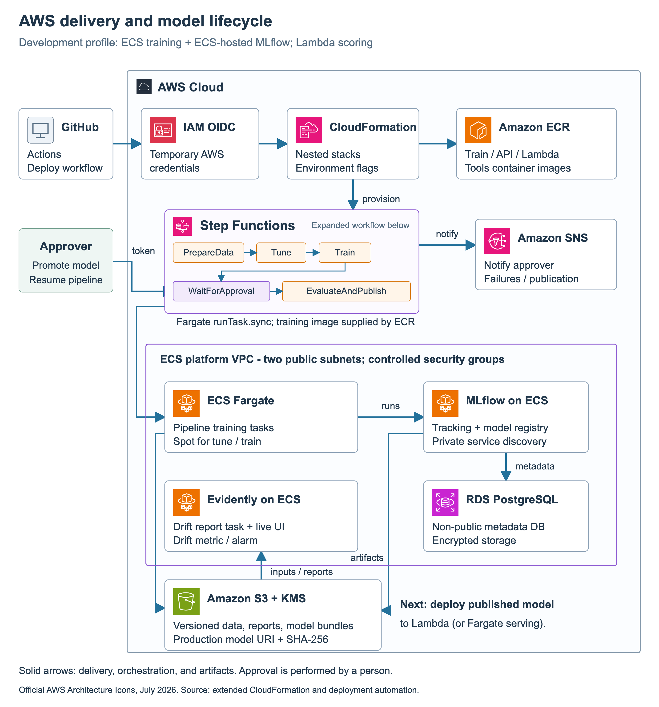
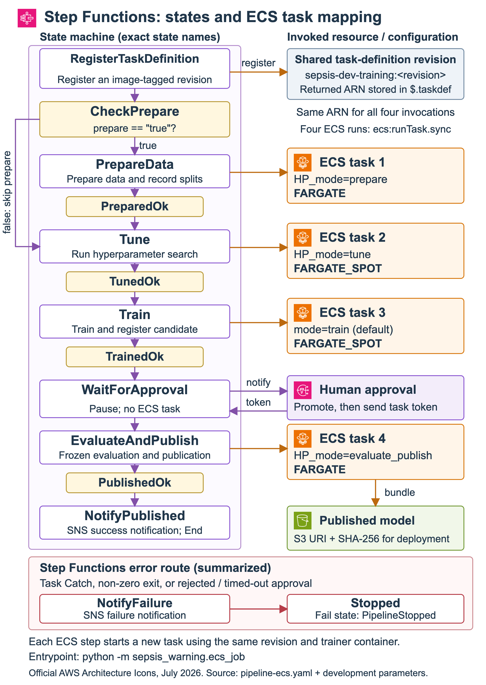
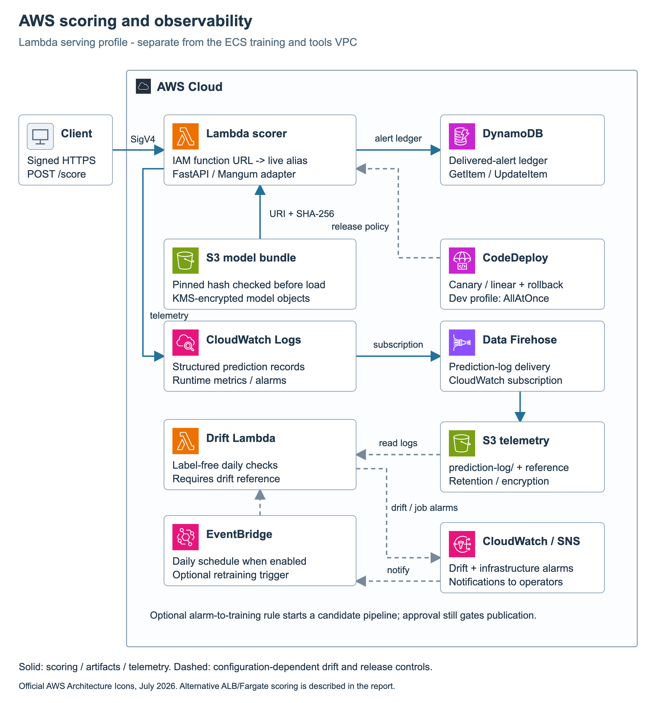
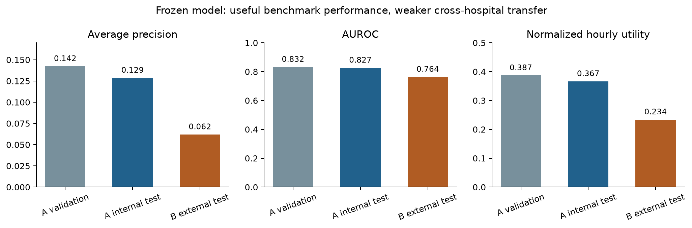
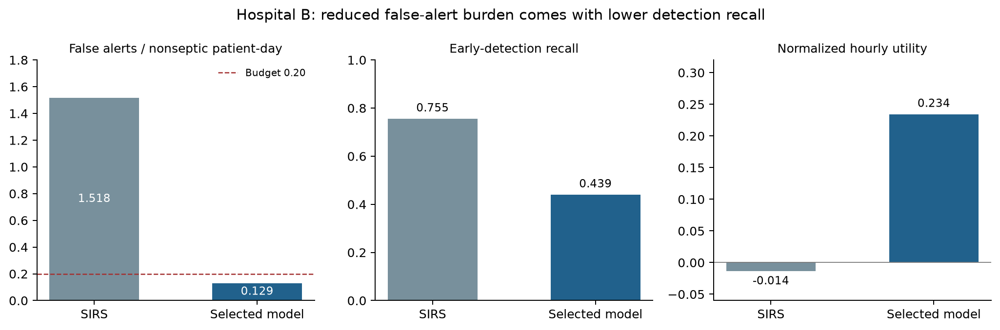
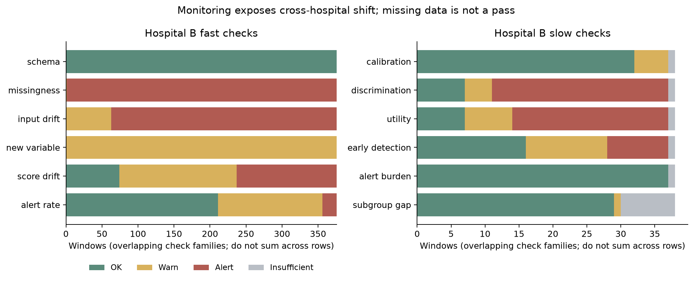

\newpage

**Report ID:** LV-20261126-1412  
**Status:** Final project submission  
**Project scope:** Cross-hospital sepsis prediction, reproducible experimentation, and automated AWS delivery  
**Revision:** 5 - Expanded Step Functions workflow and ECS task mapping

# Executive summary

The implemented research pipeline successfully processed the complete public
PhysioNet Challenge 2019 training cohorts, trained and compared four classical
models, reproduced the supplied experiment's aggregate results, and served the
selected model through a local scoring API.

The solution was also **deployed and tested on AWS using GitHub Actions,
ECS Fargate, and AWS Lambda**. Its infrastructure-as-code supports containerized
training, experiment tracking, approval-based model publication, authenticated
serverless scoring, and operational monitoring.

The project demonstrates **end-to-end software execution, numerical
reproducibility, and cloud delivery**. These engineering outcomes are distinct
from clinical validation or a new independent external validation study.

| Project objective | Outcome |
|---|---|
| Does the complete local software test suite pass? | Yes: 145 tests passed; none skipped. Warnings remain. |
| Can the pipeline process the complete available real dataset? | Yes: 40,336 stays and 1,552,210 hourly rows passed hard schema checks. |
| Are the supplied model results reproducible? | Yes: validation and held-out aggregate metrics matched within the recorded numeric tolerances. |
| Does local inference agree with batch/CLI inference? | Yes: the recorded 51-hour parity case had zero probability difference and identical decisions and notifications. |
| Does the local container work? | Yes: build and synthetic end-to-end smoke checks passed on Linux ARM64. |
| Does the model transport without degradation? | No: Hospital B discrimination, utility, and early-detection recall were lower, with monitoring alerts. |
| Was the solution deployed and tested on AWS? | Yes: GitHub Actions delivery, Fargate compute, and Lambda scoring. The AWS architecture and release stages are described below. |
| How are model releases controlled? | Step Functions orchestrates training, an approval pause, frozen evaluation, and publication; scoring loads a checksum-pinned model. |
| Is clinical use supported by this evidence? | No. |

Histogram gradient boosting was selected at a **0.06 probability threshold**,
with a **six-hour notification cooldown** and an empirical validation budget
of **0.20 false alert events per nonseptic patient-day**. External Hospital B
results were AUROC **0.7635**, average precision **0.0620**, normalized hourly
utility **0.2340**, early-detection recall **0.4393**, and false-alert burden
**0.1294** per nonseptic patient-day.

The operating budget was met in the observed cohorts, but this did not prevent
loss of detection performance. The demonstrated system remains a research
application, not a clinical decision-making tool.

# Project scope and experimental design

## What was executed

The recorded run covered:

- The complete unit/invariant test suite, causal-feature script, and synthetic demo.
- Real-data preparation, saved splits, hard schema validation, and diagnostic extreme-value counts.
- SIRS and always-no baselines; four candidate models; calibration, selection, and held-out evaluation.
- Supplementary missingness, SIRS failure-pattern, and hospital-comparison analyses.
- Local MLflow tracking, saved-model replay, API parity/validation, and nine latency scenarios.
- Monitoring-reference construction and both internal- and external-test monitoring replays.
- Docker build and synthetic container serving checks.
- Browser inspection of the MLflow run, API documentation, and interactive synthetic ward replay.
- Hospital B API examples and synthetic robustness probes for split and feature contracts.

## Measurement scope

The detailed test counts, model metrics, and latency measurements in this
report belong to the recorded full-cohort research run. The AWS section
describes the extended deployment implementation and its environment
parameters. Cloud deployment does not turn local latency measurements into
cloud performance measurements. Hosted run IDs, cloud latency distributions,
and release-specific rollback results are not included in the experiment
record. DVC push/reproduction, notebook execution, and separate experimental
HMM fitting are outside the recorded run.

Full-cohort training used the native Python environment. The container smoke
test trained and served a **synthetic** model inside the image; it did not
certify full-cohort container training or real-model cross-platform operation.

The dataset was already present locally; no fresh download was required.
Existing datasets and experiment outputs were preserved. Runtime source code
was not changed to obtain these results.

The original repository snapshot had no available Git commit, so this is not
a commit-addressed release certification. An additional report-time digest of
the experimental source/configuration files is recorded in [the evidence manifest](evidence.json);
it does not retroactively restore the missing training revision.

# AWS design and deployment

## Infrastructure and environment configuration

The platform is defined by the [extended CloudFormation root stack](../../infra%20copy/cloudformation/root.yaml),
its nested templates, and the [deployment automation](../../scripts%20copy/aws_deploy.sh).
The infrastructure separates artifact storage, training orchestration,
experiment tracking, serving, and observability.

The [development configuration](../../infra%20copy/params/dev.json) selects
**ECS Fargate training**, **MLflow on ECS with RDS PostgreSQL**, and
**Evidently monitoring**. SageMaker is disabled in this profile. Scoring
defaults to **Lambda**. This is different from the root template's generic
SageMaker defaults; the diagrams show the development profile rather than
combining mutually exclusive backends.

Fargate training uses a dedicated VPC with two public subnets and controlled
task security groups, avoiding a NAT gateway. Public task IP assignment does
not make the MLflow database public: RDS has `PubliclyAccessible=false`.
The optional Fargate *scoring* mode uses a separate network design with an
internal ALB and private tasks. These two Fargate use cases are not the same
deployment topology.

## Architecture overview

The first view connects automated delivery to the governed model lifecycle.
GitHub OIDC supplies temporary deployment credentials; CloudFormation
assembles the platform; ECR stores separate training, scoring, Lambda, and
tools images. Step Functions runs prepare, tune, and train tasks, pauses for
approval through SNS, then evaluates and publishes the frozen model.

{width=100%}

[Editable deployment diagram (SVG)](figures/aws-delivery-architecture.svg).

The expanded workflow maps each `ecs:runTask.sync` state to its own ECS task
invocation. All four invocations reuse the revision created by
`RegisterTaskDefinition`; their mode and capacity-provider overrides select
the work. `Train` uses the entry point's default `train` mode.
`CheckPrepare` can bypass preparation. Approval and notification states use
SNS, not ECS; the four exit-code checks and the summarized failure route are
shown separately from the normal execution path.

{width=100%}

[Editable Step Functions/ECS workflow (SVG)](figures/aws-step-functions-ecs-workflow.svg).

The runtime view shows the Lambda scoring and telemetry path. Signed requests
reach the `live` alias through an IAM-authenticated function URL. The function
loads a SHA-256-pinned bundle from S3 and uses DynamoDB as an alert-delivery
ledger. CloudWatch prediction records flow through Firehose to S3.

{width=100%}

[Editable application/operations diagram (SVG)](figures/aws-runtime-architecture.svg).
Solid connectors show the principal request, artifact, or telemetry flows.
Dashed connectors identify configuration-dependent monitoring and release
controls, not components that are always enabled.

The diagrams use the official July 2026
[AWS Architecture Icons](https://aws.amazon.com/architecture/icons/).
The figures are derived from template resources, conditions, and deployment
commands; they are architecture views, not account-specific resource inventories.

## Component responsibilities and implementation

| Component | Responsibility | Implementation |
|---|---|---|
| GitHub Actions and IAM OIDC | Automated, environment-specific delivery. | Bootstrap trust roles plus change-based deployment planning; no long-lived AWS keys are required. |
| CloudFormation | Compose and parameterize the platform. | Conditional nested stacks separate Lambda/Fargate serving and ECS/SageMaker training. |
| Step Functions and Fargate | Govern training and publication. | Prepare, tune, train, approval callback, evaluate/publish, and failure notifications. |
| MLflow, RDS, and S3 | Experiment tracking and model registry. | ECS-hosted MLflow, non-public PostgreSQL metadata, S3 artifacts, candidate/production aliases. |
| ECR | Container distribution. | Separate scoring-api, scoring-lambda, training, and tools repositories with scanning. |
| Lambda | Authenticated scoring. | Function URL with AWS IAM, `live` alias, pinned model URI/hash, DynamoDB ledger. |
| S3 and KMS | Artifact and telemetry retention. | Encrypted/versioned artifacts, model publications, prediction logs, and lifecycle policies. |
| CloudWatch, Firehose, and SNS | Runtime telemetry and notifications. | Prediction-log subscription to Firehose/S3, infrastructure alarms, approval and failure messages. |
| EventBridge and drift Lambda | Scheduled label-free checks. | Created when a drift reference is supplied; retraining starts only when its additional configuration is supplied. |
| Evidently on ECS | Drift reports and UI. | Enabled in the development profile; separate report task, UI service, and drift alarm. |

## Release controls, alternatives, and operational learnings

The deployment stages are **validate, plan, stack/images, readiness,
optional retraining, publish/serve, smoke test, verify, and record state**.
The deployment helper passes the published `ModelS3Uri` and `ModelSha256`
into the serving stack. Both the Lambda entry point and the Fargate serving
command support checksum-verified model retrieval; the earlier local-only
image path is not the cloud model-delivery mechanism.

The [Lambda template](../../infra%20copy/cloudformation/serverless.yaml)
uses versioned aliases and configurable CodeDeploy traffic shifting with
error/duration alarms. The development profile deliberately selects
`AllAtOnce`; the root template also supports canary and linear policies.
Human approval remains in the training/publication lifecycle regardless of
whether a drift alarm starts a new candidate run.

Optional modes are explicit:

- `TrainingBackend=sagemaker` replaces ECS training tasks with SageMaker jobs.
- `MlflowBackend=sagemaker` enables the SageMaker MLflow App instead of ECS/RDS.
- `ServingMode=fargate` replaces Lambda scoring with ALB/private Fargate serving.
- A private API Gateway/WAF stack requires `PrivateApiVpcEndpointId`; it is
  not part of the baseline Lambda function-URL path.
- Scheduled drift requires `DriftReferenceS3Uri`; an alarm-to-training rule
  additionally requires the pipeline and `RetrainImageTag`. Neither implies
  automatic production promotion.

The main operational learning is to separate **deployment health** from
**model validity**. Infrastructure alarms, checksum checks, and successful
requests do not establish calibration, retained cross-hospital sensitivity,
or acceptable clinical risk.

## Cost and reliability trade-offs

The ECS backend provides a training route when SageMaker access or instance
quotas are constrained. Pipeline tasks run on demand, with Spot capacity for
tuning/training. Lambda scoring can scale to zero, but ECS-hosted MLflow,
Evidently, and RDS are not a zero-standing-cost platform; the power controls
start and stop hosted tools. The development budget is USD 20 per month as an
alert threshold, not a spending cap.

The development RDS configuration is single-AZ with a one-day backup
retention period. It suits a demonstration rather than a high-availability
clinical service. Production extensions include stronger recovery targets,
tighter deployment-role permissions after bootstrap, and explicit
availability and cost measurements.

# Dataset, method, and operating policy

## Complete-cohort selection and split verification

Preflight found that the unused local directory named `physionet-full`
contained 20,335 Hospital A records. The complete local copy,
`physionet-complete-20261114`, contained the expected **20,336 A records and
20,000 B records** and was used instead. Directory names were not treated as
evidence of completeness.

| Split | Source | ICU stays | Septic stays | Hourly rows |
|---|---|---:|---:|---:|
| Training | A | 11,183 | 984 | 435,449 |
| Calibration | A | 3,051 | 269 | 117,195 |
| Validation | A | 3,051 | 268 | 118,668 |
| Internal test | A | 3,051 | 269 | 118,903 |
| External test | B | 20,000 | 1,142 | 761,995 |
| **Total** | **A and B** | **40,336** | **2,932** | **1,552,210** |

Splitting used seed **42**, stratified source-A stays, and whole-record
assignment rather than patient-hour splitting. The saved assignment and the
actual training manifest were checked for one-to-one agreement. Actual input
and split-file SHA-256 values were checked against the recorded metadata.

The unit is an **ICU stay**, not a known person. The dataset does not provide
person identifiers sufficient to guarantee person-disjoint evaluation.

Hospital B was excluded from estimator fitting, calibration, and model/threshold
selection in this execution. However, B has been inspected in earlier
exploration and repeated evaluations. It is an **exploratory external cohort**,
not a newly untouched, blinded confirmatory holdout.

## Data validation and feature construction

All 40,336 stays and 1,552,210 rows passed the implemented hard rules:
required columns, numeric measurements, no infinite values, valid nondecreasing
binary labels, and consecutive recorded ICU hours.

Passing these checks does not prove that every value is physiologically
plausible. Extreme-value diagnostic flags were retained for investigation rather
than automatically clipped or silently discarded.

The selected pipeline used **276 features**, a six-hour feature window,
patient-local forward filling, missingness/never-observed indicators,
measurement age, and trailing summaries. Learned imputation/scaling and
estimators were fitted on training data; sigmoid calibration used a separate
calibration cohort. Constant-prior predictions were not separately calibrated.
Administrative unit codes and record/hospital identifiers were excluded from
model inputs.

## Selection policy and metric interpretation

Models and probability thresholds were selected using A validation only.
Threshold candidates were evaluated against the empirical notification budget;
the candidate model with the highest normalized hourly utility was selected,
with the implemented false-alert/AP tie-breaks.

The following distinctions apply throughout this report:

- **Target:** `SepsisLabel` is the supplied benchmark label, already shifted
  six hours before dataset-defined onset. It is not shifted again.
- **Probability:** the score estimates that benchmark label, not a clinically
  validated probability of first sepsis onset within the next six hours.
- **Hourly decision versus notification:** `hourly_positive` applies the
  threshold every hour; `alert_event` additionally enforces the cooldown.
- **Utility:** normalized hourly utility uses hourly decisions and the
  published challenge weighting, not cooldown-suppressed notifications.
- **False-alert budget:** events in stays that never have a positive label,
  divided by their observed hours/24. It does not count every potentially
  unhelpful notification in an eventual septic stay.
- **Early-detection recall:** useful pre-onset notifications divided by
  eligible septic stays. First-row-positive stays and records ending before
  inferred onset are excluded. This is not hourly label recall.
- **Lead time:** retrospective and inferred. It is not prospective proof of
  additional treatment time or clinical benefit.

No new threshold or model setting was selected from B results during this
verification. The validation budget is a demonstration policy, not a
clinician-approved tolerance.

# Verification outcomes

| Area | Recorded evidence | Assessment |
|---|---|---|
| Dependencies | Installed native environment passed `pip check`. | Consistent locally; not a fully locked release environment. |
| Tests | 145 passed in 42.375 seconds; zero skipped. | Passing software tests, with warnings. |
| Complete data | 40,336 stays; 1,552,210 rows; hard rules passed. | Full-cohort execution confirmed. |
| Provenance | Actual Parquet/split hashes and saved/training assignments matched. | Dataset/split identity verified for this run. |
| Model outputs | Required model, configuration, metadata, comparison, predictions, and replay files present. | Complete local experiment outputs. |
| Numerical reproduction | Validation and held-out aggregate metrics matched the supplied run at `rtol=1e-10`, `atol=1e-12`. | Reproducible in the recorded environment; not statistical replication on new data. |
| Prediction accounting | Held-out metrics recomputed from 880,898 saved prediction rows. | Saved predictions and reported metrics agree. |
| Tracking | One MLflow run finished; four allowlisted aggregate artifacts logged. | Local persistence confirmed; no model registry/promotion demonstrated. |
| API parity | 51-hour synthetic-history case; maximum absolute probability difference 0.0. | CLI/API probabilities, decisions, notifications, and prefix behavior agree for the case. |
| Input rejection | Label-bearing request returned HTTP 422. | Target leakage through the request contract rejected. |
| Container | Build, non-root UID 10001, image hygiene, health, scoring, and HTTP 422 checks passed. | Local synthetic smoke passed, not cloud deployment proof. |
| UI | MLflow finished run/metrics visible; API docs rendered; ward control advanced from hour 24 to 25. | Local user-facing paths exercised. |

The container smoke checks were executed as equivalent explicit local commands
with a dedicated fixture and bounded resources; this report does not claim
that a hosted Actions run or the repository's entire shell wrapper was executed.

## Warnings and execution exceptions

The passing test run emitted a Starlette/httpx deprecation warning,
empty-histogram NumPy warnings, and one test-fixture logistic-regression
convergence warning at its 500-iteration limit. The recorded full-cohort
training log did not contain that convergence warning. Warnings were not
treated as proof of model failure, nor were they suppressed or reported as
an error-free run.

An optional MLflow assistant-configuration endpoint initially returned HTTP
500 during first browser load; a retry returned HTTP 200. The main run page,
finished status, and metrics rendered successfully. This was an ancillary
UI initialization issue, not a failed training or tracking run.

# Model results and operational trade-offs

## Validation-only candidate comparison

| Candidate | AP | AUROC | Brier | Utility | False alerts/day | Threshold |
|---|---:|---:|---:|---:|---:|---:|
| Constant prior | 0.0217 | 0.5000 | 0.0213 | 0.0000 | 0.0000 | 1.01 |
| Logistic regression | 0.1047 | 0.7954 | 0.0204 | 0.2499 | 0.1505 | 0.06 |
| Random forest | 0.1282 | 0.8186 | 0.0201 | 0.3581 | 0.1851 | 0.06 |
| **Histogram gradient boosting** | **0.1424** | **0.8323** | **0.0199** | **0.3870** | **0.1851** | **0.06** |

AP means average precision. False-alert rates in these tables are events per
observed nonseptic patient-day. Threshold 1.01 is the explicit no-alert
fallback, including when a probability equals 1.

## Selected model across cohorts

| Metric | A validation | A internal test | B external test |
|---|---:|---:|---:|
| Positive-label hourly fraction | 0.0217 | 0.0217 | 0.0141 |
| Average precision | 0.1424 | 0.1287 | 0.0620 |
| AUROC | 0.8323 | 0.8266 | 0.7635 |
| Brier score | 0.0199 | 0.0199 | 0.0137 |
| Normalized hourly utility | 0.3870 | 0.3665 | 0.2340 |
| Early-detection recall | 0.5820 | 0.5429 | 0.4393 |
| False alert events/nonseptic day | 0.1851 | 0.1734 | 0.1294 |
| Eligible septic stays for early detection | 244 | 245 | 906 |
| Left-censored septic stays | 24 | 23 | 223 |
| Median inferred lead time, detected eligible stays | 8 h | 9 h | 9 h |

{width=100%}

Relative to A internal test, B AUROC was **0.0631 lower**, utility was
**0.1325 lower**, and early-detection recall was **10.36 percentage points
lower**. These are descriptive differences; no confidence intervals or
significance claim are supplied.

B has a lower positive-hour prevalence. Consequently, its lower AP and Brier
score cannot be interpreted as pure changes in ranking and calibration,
respectively. In particular, the lower Brier score on B is not sufficient
evidence of improved calibration.

## Hourly classification at the frozen threshold

These metrics were recomputed from saved held-out predictions. They evaluate
hourly label decisions, not cooldown notifications.

| Cohort | Precision | Recall | F1 | Specificity | Accuracy |
|---|---:|---:|---:|---:|---:|
| A internal test | 0.1219 | 0.4536 | 0.1922 | 0.9276 | 0.9174 |
| B external test | 0.0829 | 0.3266 | 0.1322 | 0.9481 | 0.9393 |

Accuracy is not a suitable primary success criterion: always predicting no
positive hours achieves **0.9859** accuracy on B while detecting none.

## Comparison with SIRS on Hospital B

| Measure | SIRS baseline | Selected model |
|---|---:|---:|
| Normalized hourly utility | -0.0136 | 0.2340 |
| Early-detection recall | 0.7550 | 0.4393 |
| False alert events/nonseptic day | 1.5176 | 0.1294 |
| Observed false-alert budget met? | No | Yes |

The model reduced false-alert burden by **91.5%** relative to the standard
SIRS comparator, but early-detection recall was lower. SIRS exceeded the
0.20 budget by approximately **7.59 times**. It is therefore inaccurate to
describe the model as better on every dimension.

{width=100%}

**Outcome:** constrained notification behavior and positive benchmark utility
were demonstrated. Acceptable clinical sensitivity, calibrated individual
risk, and benefit to patients were not established.

# Monitoring, shift, and subgroup learnings

## Frozen reference and windowing

The reference used A-training inputs and A-validation scores/performance from
the frozen bundle. The replay checked the bundle SHA-256 against that
reference. Default fast windows target **2,000 patient-hours**; slow windows
target **20,000 patient-hours**, with whole stays kept together.

These are seeded, shuffled retrospective windows, not observed calendar-time
monitoring periods. Minimum sample rules remain active. Tail records that
cannot fill a window are reported but not assessed as a monitoring window.
The pooled cohort metrics still use the full scored cohort.

The performance reference uses the same validation cohort that selected the
threshold, so some optimism is expected. Many statistics are checked in each
window; isolated warnings are not independent statistical discoveries.
Fast alerts generally require consecutive breaches, while schema failures
are immediate.

## Observed monitoring statuses

| Check | A internal alerts/windows | B external alerts/windows | B insufficient windows |
|---|---:|---:|---:|
| Schema | 0/58 | 0/376 | 0 |
| Missingness | 0/58 | 375/376 | 0 |
| Input drift | 0/58 | 313/376 | 0 |
| Score drift | 0/58 | 139/376 | 0 |
| Alert rate | 0/58 | 20/376 | 0 |
| Calibration | 0/5 | 0/38 | 1 |
| Discrimination | 0/5 | 26/38 | 1 |
| Utility | 1/5 | 23/38 | 1 |
| Early detection | 0/5 | 9/38 | 1 |
| False-alert burden | 0/5 | 0/38 | 1 |
| Subgroup gap | 0/5 | 0/38 | 8 |

An additional new-variable check warned in **all 376 B fast windows** and
never escalated to an alert, by design. Check families overlap; counts must
not be added to infer a number of independent incidents. Denominators above
include insufficient windows, which are not passing windows.

{width=100%}

### Interpretation

- **Schema validity is not distribution stability.** B passed schema checks
  while missingness, inputs, and scores shifted substantially.
- **Lower notification burden is not proof of retained sensitivity.** B
  stayed within budget while discrimination, utility, and early recall degraded.
- **Fast drift alone is not model failure.** Here, slow settled-label checks
  also supplied evidence of performance degradation.
- **The internal cohort was not uniformly quiet.** One of its five slow
  windows raised a utility alert. This requires review of variability and case mix,
  not automatic dismissal or post-hoc relaxation of thresholds.
- **No calibration alert does not mean every calibration check passed.**
  B had 32 OK, five warning, and one insufficient calibration window.
- **No automatic retraining occurred.** A model, calibration, or policy
  change requires approval, a new bundle/reference, and suitable new evaluation data.

B tails not assessed as windows were **1,002 fast-window hours** and
**1,114 slow-window hours**. A internal tails were **1,432** and **18,782**
hours, respectively. The latter is material relative to the five evaluated
internal slow windows and should temper conclusions about monitoring coverage.

## Missingness and subgroup outcomes

The training/validation missingness study completed on **11,183 training**
and **3,051 validation** stays. Across five fixed logistic-regression
strategies, validation AP ranged from **0.0891 to 0.0985** and AUROC from
**0.7133 to 0.7862**. The highest AP and highest AUROC came from different
strategies. These exploratory variants were not substituted into the selected
model and are not an equivalent-feature comparison with the main pipeline.

The pooled external subgroup utility estimates were:

| Recorded attribute | Group | Septic stays | Normalized utility |
|---|---|---:|---:|
| Sex | Female | 495 | 0.2434 |
| Sex | Male | 647 | 0.2269 |
| Age | Under 45 | 200 | 0.2182 |
| Age | 45-64 | 427 | 0.2227 |
| Age | 65-79 | 386 | 0.2634 |
| Age | 80+ | 129 | 0.2066 |

These descriptive estimates do not establish fairness. Eight external
subgroup-monitoring windows lacked sufficient data; confidence intervals,
broader attributes, and prespecified subgroup acceptance criteria are absent.

# Serving and performance results

## Request contract and functional examples

The API is stateless: every request supplies one stay's history from its
first available recorded ICU hour through the current hour. Omitted clinical
fields mean missing observations. Labels, hospital IDs, administrative unit
codes, and unknown measurement fields are rejected.

The native API loaded the newly trained real-data model with the expected
bundle checksum. Recorded parity checks confirmed matching CLI/API
probabilities, identical threshold decisions/notifications, and unchanged
prefix results.

A separately selected Hospital B functional example had benchmark label 0
initially and label 1 by hour 6. Sending the complete six-row prefix, without
the label, produced:

| Final example hour | Model probability | Threshold | Hourly positive | Notification |
|---:|---:|---:|---:|---:|
| 6 | 0.07770351104741265 | 0.06 | 1 | 1 |

This case was deliberately selected to exercise the positive response path.
It is not a random performance sample or independent evidence of clinical
detection. A positive benchmark label is not a diagnosis of sepsis at that
hour. No individual measurements or original record identifiers are included
in this submission.

## Local API latency

The benchmark used synthetic request histories against the native real-model
API, with **50 measured requests and five warmups per scenario**. Across
nine scenarios there were **450 measured requests and zero failures**.
The separately recorded first request took **61.5 ms**.

| History hours | Concurrent clients | p50 ms | p95 ms | p99 ms | Requests/s |
|---:|---:|---:|---:|---:|---:|
| 24 | 1 | 14.9 | 26.4 | 30.4 | 61.14 |
| 24 | 4 | 60.7 | 88.6 | 108.2 | 61.68 |
| 24 | 8 | 124.8 | 195.9 | 229.1 | 61.49 |
| 72 | 1 | 13.5 | 16.0 | 61.8 | 69.20 |
| 72 | 4 | 61.5 | 89.9 | 123.3 | 61.92 |
| 72 | 8 | 128.3 | 178.2 | 210.0 | 64.34 |
| 336 | 1 | 13.7 | 15.0 | 34.9 | 70.29 |
| 336 | 4 | 61.4 | 83.4 | 101.7 | 63.03 |
| 336 | 8 | 141.1 | 219.5 | 254.9 | 54.76 |

The observed p95 range was **15.0-219.5 ms**. Concurrency increased latency,
consistent with serialized prediction under the service lock. These short,
same-host measurements are not a sustained-load, soak, production-network, or
availability test. With only 50 measured requests per row, p99 estimates
should not be treated as stable tail-latency guarantees. No agreed latency
SLO was available, so this is a measurement result, not an SLO pass.
The host was shared rather than dedicated to this test. Memory high-water
marks and total training wall time were not formally profiled.

# CI/CD and MLOps outcomes

## Implemented capabilities versus remaining scope

| Capability | Project implementation | Outcome and boundary |
|---|---|---|
| Continuous integration | PR/main/manual triggers; unit/invariant tests, causal script, synthetic demo, Docker smoke job. | The recorded full local suite passed 145 tests. |
| Data versioning | DVC preparation/splitting definitions and matching dataset/split hashes. | DVC restore/repro/push and shared recovery were not exercised in this run. |
| Training/evaluation | Separate train/calibration/validation responsibilities; saved bundle; held-out metrics. | Immutable release lineage, holdout access gates, and model-promotion criteria require additional evidence. |
| Tracking | Local MLflow run; ECS/RDS tracking backend in the cloud configuration. | Experiment metadata and artifacts are separated; registry aliases support approval-based release. |
| Serving | Native API parity; synthetic container smoke; Lambda scoring and alternative Fargate serving. | IAM protects the Lambda URL; a live hospital feed is outside project scope. |
| Monitoring | Two-speed retrospective replay plus conditional cloud drift jobs and Evidently reports. | Label-free cloud drift does not replace settled-label performance evaluation. |
| Delivery/recovery | Change-based deploy planning, checksum-pinned S3 publication, Lambda release policies, and verification commands. | Retain source/image/model identities together; local load figures are not cloud SLOs. |

The CI definition also uses read-only repository permissions, disables
checkout credential persistence, and refuses tracked patient/model artifacts.
The alternative Fargate ALB defaults to **internal**, not public; network placement
does not replace application authentication.

## Engineering challenges and improvements

### Checksum-bound cloud model delivery

The extended [Fargate service definition](../../infra%20copy/cloudformation/service.yaml)
passes the model S3 URI and checksum explicitly. The
[shared cloud loader](../../src%20copy/sepsis_warning/model_source.py)
requires a pinned SHA-256 for S3 models; the
[Lambda entry point](../../src%20copy/sepsis_warning/lambda_app.py)
uses the same loading path and initializes the DynamoDB ledger.
This closes the architectural gap between an image expecting a local model
file and an independently published cloud model.

### Research-pipeline robustness: hospital isolation

The [saved-split loader](../../src/sepsis_warning/splits.py#L61) validates split
names and record membership but does not enforce the hospital/split boundary.
An isolated synthetic probe reassigned **30 B stays** to training and the
loader accepted them.

**Improvement:** reject duplicate assignments, disallowed
hospital/split combinations, and dataset/split identity mismatches before
training; add a regression test for the rejected case.

### Research-pipeline robustness: monitoring split identity

[Monitoring setup](../../src/sepsis_warning/monitoring.py#L800) regenerates
cohorts from a seed instead of consuming a model-bound immutable assignment.
A synthetic seed-7 model accepted a seed-42 reference: its monitoring
validation cohort contained **eight original training stays and six original
internal-test stays**.

**Improvement:** bind model, exact dataset, and saved split
manifest; refuse mismatches at setup and replay.

### Research-pipeline robustness: transformation semantics

The [service compatibility check](../../src/sepsis_warning/service.py#L75)
checks feature availability, and the recorded hash covers ordered column
names rather than transformation behavior. A synthetic probe multiplied
`HR__last` by ten without renaming columns. Startup remained `ok`, the hash
was unchanged, and predictions changed.

**Improvement:** an enforced transformation-contract version or
implementation digest, supported dependency compatibility, and saved-bundle
prediction-parity regression tests.

**Scope of the three robustness probes:** these are deliberately adversarial
synthetic probes. They do not show contamination in the correctly configured
full-cohort run, whose actual saved/training assignments and hashes matched.
Passing 145 existing tests did not detect these missing safeguards.

### Reproducibility and release identity

The fresh run now includes verified split/source hashes, but still records
`git_commit: null`. In addition, the [training manifest path](../../src/sepsis_warning/cli.py#L87)
can substitute an ID hash for a data-content hash when Parquet inputs lack
adjacent raw files. That fallback was not used for this raw-file training run.

**Improvement:** a release manifest linking a committed source
revision, data/split content hashes, dependency lock, model checksum, feature
contract, alert policy, and monitoring reference. Missing lineage must fail
explicitly rather than resemble valid content evidence.

### Platform consistency

The [CI workflow](../../.github/workflows/tests.yml#L48) resolves dependency
ranges, while the [Docker build](../../Dockerfile) pins the scientific stack
but resolves serving extras separately. The observed native API used Python
**3.12.14** and FastAPI **0.162.7**; the built container used Python
**3.12.16** and FastAPI **0.165.0**.

The locally measured image is **Linux ARM64**. Cloud deployment automation
instead defaults to **Linux AMD64**, matching the ECS task platform.
Lambda exposes a separate architecture parameter. Consequently, the local
smoke result and the cloud build are different platform records, not
interchangeable binaries.

**Learning:** lock dependencies and preserve platform-specific image identity
with model identity. A successful ARM64 smoke test alone is not an AMD64 test.

### CI coverage and required checks

Local validation had the optional checks installed. The current workflow
installs only serving/test extras, so the [Pandera hard-rule tests](../../tests/test_schema.py#L23)
can skip on a clean CI environment. CloudFormation linting and controlled
model-quality/promotion gates are not part of this workflow. Existing
[tracking tests](../../tests/test_tracking.py) primarily use a fake MLflow
client; the real local integration was exercised separately in this run.

**Improvement:** make required extras/checks explicit, fail
unexpected skips, add infrastructure validation and a small real local
tracking integration check, and retain aggregate validation evidence.
Do not upload patient-level data to public CI to achieve this.

## Source-version boundary

The numerical experiments and robustness probes describe the research
implementation identified in Appendix A. The cloud architecture describes
the extended deployment templates and application adapters identified in
Appendix C. New cloud functionality does not retroactively change the
recorded 145-test result, repair the missing Git revision of that run, or
establish that every research-pipeline robustness issue is resolved.

# Learnings and recommended next actions

## Engineering and model learnings

| Learning | Evidence and consequence |
|---|---|
| Verify data content, not directory names. | One local copy was incomplete; counts and canonical hashes identified the complete copy. |
| Successful execution is narrower than complete assurance. | All 145 tests passed, while three adversarial control probes exposed missing invariants. |
| Preserve metric semantics. | Hourly decisions, notifications, utility, early recall, and false-alert denominators answer different questions. |
| A notification budget is not a sensitivity guarantee. | B burden remained below budget while early recall and utility fell. |
| Source shift is both a data and a performance concern. | B passed schema but raised persistent input/missingness and settled-label performance alarms. |
| Match training, serving, and deployment contracts. | Native parity passed; S3 URI/hash binding carries explicit model identity into Lambda and Fargate serving. |
| Separate cloud roles clearly. | Fargate runs training and hosted tools in the development profile; Lambda serves scoring. Alternative backends are selected through parameters, not assumed to run simultaneously. |
| Treat insufficient evidence explicitly. | Sparse subgroup windows and absent uncertainty estimates prevent strong fairness or clinical conclusions. |
| Keep claims and documentation versioned. | Earlier design/risk documents predate this execution. New real-data evidence updates those historical execution claims, not all open risks. |

## Prioritized future work

The following extensions prioritize reproducibility, robustness, and
operational maturity. They are future work, not new clinical acceptance thresholds.

| Priority / gate | Action | Proposed owner | Objective evidence for closure |
|---|---|---|---|
| P0: before new model promotion | Enforce hospital/split binding and semantic compatibility in the research pipeline. | Data engineering and MLOps | Adversarial regression cases reject unsafe inputs/changes; correct cases retain parity. |
| P1: release identity | Preserve cloud image, model, source, and platform identity in one release manifest. | Serving/platform engineering | Immutable image identity, expected model checksum, and retained scoring/health results. |
| P1: release hardening | Extend required CI checks and dependency locks across the delivery path. | MLOps and platform engineering | Workflow/run reference, controlled locks, required extras, and aggregate deployment test evidence. |
| P1: recovery verification | Rehearse coordinated rollback across application and model artifacts. | Platform engineering | Post-deploy tests and rollback evidence covering compute, model, policy, and monitoring reference. |
| P1: before performance acceptance | Quantify uncertainty and investigate cohort/window failures. | Model validation | Patient/stay-bootstrap intervals, calibration/PR reporting, reviewed internal utility alarm, and prespecified gates. |
| P2: monitoring verification | Reconcile AWS telemetry, delayed-label joining, schedules, and notifications with offline monitoring. | Operations and data engineering | Deployed component mapping and end-to-end monitoring/failed-job alert evidence. |
| Separate authorization | Review privacy, licensing, clinical protocol, and independent prospective evaluation. | Accountable project/domain reviewers | Explicit approvals and new governed evidence; not inferred from this report. |

Investigations must not use B outcomes to retune choices and then continue
describing B as an independent test. Any changes motivated by these results
need a separately governed evaluation design. Do not relax monitoring
thresholds merely to make the current alarms disappear.

# Limitations and conclusion

The principal limitations are:

1. One fixed stay-level split, one public source pair, and already inspected
   external data. Repeating the same experiment is numerical reproduction,
   not a new independent generalization study.
2. No patient/stay-bootstrap confidence intervals, prospective validation,
   causal treatment-effect evidence, or clinical acceptance thresholds.
3. Missing person identifiers, heavy missingness, administrative measurement
   effects, first-row-positive records, and post-onset positive labels.
4. An inferred retrospective onset and conditional lead-time denominator;
   the nine-hour detected-case median is not a population-wide promise.
5. Local synthetic API load, short scenarios, same-host networking, and no
   production availability, security, disaster recovery, or sustained-load assessment.
6. Offline simulated monitoring, non-evaluated tails, and insufficient
   subgroup windows. No prospective fairness finding is justified.
7. Missing Git revision and open release controls despite successful
   data/split hashing and numerical agreement.
8. The repository records an unresolved data-redistribution/licence-notice
   review under R14. This execution did not resolve it or authorize sharing
   data, model files, or individual trajectories.
9. The reported latency and test timings are local measurements, not cloud
   performance guarantees. Environment flags control optional cloud resources;
   the architecture does not imply every supported mode is enabled.

## Project conclusion

The project delivered a reproducible cross-hospital research pipeline,
full-cohort model comparison, calibrated scoring, alert-policy evaluation,
experiment tracking, retrospective monitoring, and an AWS delivery platform.
The recorded run passed **145 tests**, processed **40,336 ICU stays**, and
reproduced the supplied aggregate results. Native batch/API parity and
synthetic container operation completed successfully.

The principal model finding is a measurable transportability gap:
Hospital B AUROC was **0.7635**, normalized utility **0.2340**, and
early-detection recall **0.4393**. The model reduced false-alert burden by
**91.5%** relative to SIRS, but detected fewer eligible septic stays.
Meeting a notification budget therefore cannot substitute for assessing
clinical sensitivity.

The principal engineering contribution is the separation of model lifecycle
and runtime concerns: Step Functions/Fargate training, MLflow tracking,
approval-based publication, checksum-bound Lambda scoring, and explicit
telemetry and drift paths. Future work should strengthen split/feature
contracts, quantify uncertainty, preserve immutable release lineage, and
evaluate prospective performance. Clinical deployment requires a separate
validation and authorization process.

\newpage

# Appendix A: environment and reproducibility identity

| Item | Recorded value |
|---|---|
| Native host | macOS ARM64; Python 3.12.14 |
| Numeric-library thread settings | OMP, OpenBLAS, and MKL limited to two threads for the recorded commands |
| Scientific stack | NumPy 2.5.4; pandas 3.1.1; SciPy 1.18.1; scikit-learn 1.7.2; Joblib 1.6.0; PyArrow 24.0.0 |
| Local tracking/checks | MLflow 3.18.0; Pandera 0.35.0 |
| Native API | FastAPI 0.162.7 |
| Container | Linux ARM64; Python 3.12.16; FastAPI 0.165.0; Uvicorn 0.54.0 |
| Model settings | Seed 42; 276 features; six-hour window; threshold 0.06; six-hour cooldown; budget 0.20 |
| MLflow run ID | `c101dd87fbd144a9bffe21c0fd67fbaa` |
| Output directory | `artifacts/local-verification-20261126-1412` |
| Original comparison directory | `artifacts/physionet-full-20261114-1526` |
| Git revision | Unavailable (`null`); not a commit-addressed release |

Recorded SHA-256 identities:

```text
Canonical Parquet
85f044951122bff3a18adaa1a5b8e86b620a752e14e6553b4c241b10706bba85

Saved split CSV
c71b3b34f59a0bf0f5de724d94de211c65f0fee83d0f72a712fa6b77f358c800

Selected model bundle
962da9cfbb65c8e73be2b2bf592bbe61d9e31ae789d9c7a0cab7a50717beecfb

Monitoring reference
ece18e4562fc0572ad6792965b27c731e3dc6ec693dd5b60b4670a5236fa062a

Report-time source/configuration snapshot
2abc8233cf78f722cdf17d60c07ab309ebe35e8fb11ec9f6617be7499ec8a080
```

The snapshot digest hashes the canonical JSON mapping of experimental source/
configuration file paths to SHA-256 values in [the evidence manifest](evidence.json).
It describes those files at report preparation, not a retroactive Git commit.

Recorded image tag:
`sepsis-warning:local-verification-20261126-1412`

Recorded local image ID:

```text
sha256:85af6667f6e8ff1aedca328b932b07da7a24cbc4c3186ab57da3fb1cbca4e1ce
```

Local inspection endpoints used during verification were the scoring API on
port 18761, MLflow on 18762, and the synthetic ward on 18764, bound to
`127.0.0.1`. They are convenience endpoints, not durable submission evidence
or production services.

# Appendix B: recorded execution commands

These excerpts describe the completed run. The existing destinations must
not be overwritten. For a new execution, choose a fresh `RUN`, verify the
dataset, and initialize an isolated local MLflow experiment/artifact location
as in the [training runbook](../../docs/runbooks/2026-11-14-training-and-mlflow.md).
Use the recorded environment rather than silently resolving newer packages.

```bash
PY=.venv/bin/python
DATA=data/physionet-complete-20261114
RUN=artifacts/local-verification-20261126-1412

export MPLBACKEND=Agg OMP_NUM_THREADS=2
export OPENBLAS_NUM_THREADS=2 MKL_NUM_THREADS=2

"$PY" -m unittest discover -s tests -v
"$PY" -m sepsis_warning prepare \
  --data "$DATA" --output "$RUN/prepared/combined.parquet"
"$PY" -m sepsis_warning split \
  --data "$RUN/prepared/combined.parquet" \
  --output "$RUN/prepared/splits.csv" --seed 42
"$PY" -m sepsis_warning validate \
  --data "$RUN/prepared/combined.parquet" \
  --splits "$RUN/prepared/splits.csv" \
  --output "$RUN/data-checks"
"$PY" -m sepsis_warning train \
  --data "$DATA" --output "$RUN/training" \
  --seed 42 --window 6 --budget 0.2 --cooldown 6 \
  --splits-summary "$RUN/prepared/splits.csv.summary.json" \
  --mlflow-uri "sqlite:///$RUN/mlflow.db"
"$PY" -m sepsis_warning monitor-setup \
  --data "$DATA" --model "$RUN/training/model.joblib" \
  --output "$RUN/monitoring/reference" --seed 42
"$PY" -m sepsis_warning monitor-replay \
  --data "$DATA" --model "$RUN/training/model.joblib" \
  --reference "$RUN/monitoring/reference/monitoring_reference.json" \
  --split external_test --output "$RUN/monitoring/external-test"
```

The internal monitoring replay used `--split internal_test` and its own new
output directory. Baseline, supplementary analysis, synthetic CI, container,
and latency logs are retained alongside the main logs in the recorded run
directory. The latency invocation used `--hours 24 72 336`,
`--concurrency 1 4 8`, `--requests 50`, and `--warmup 5`.

# Appendix C: evidence index and submission handling

The self-contained PDF/HTML and the aggregate evidence/figures are the project
deliverables. Links below resolve in the project checkout. Raw records,
patient-level predictions, executable model bundles, individual replay
trajectories, request observations, databases, and credentials are **not**
part of the submission package.

| Evidence | Source and purpose |
|---|---|
| E01 | [Execution summary](../../artifacts/local-verification-20261126-1412/verification-summary.json): completed steps, verification checks, warnings, exclusions. |
| E02 | [Model metrics](../../artifacts/local-verification-20261126-1412/training/metrics.json) and [validation comparison](../../artifacts/local-verification-20261126-1412/training/validation_models.csv): primary model results. |
| E03 | [Run metadata](../../artifacts/local-verification-20261126-1412/training/run_metadata.json) and [split summary](../../artifacts/local-verification-20261126-1412/prepared/splits.csv.summary.json): settings and lineage. |
| E04 | [Test log](../../artifacts/local-verification-20261126-1412/tests.log): 145 passing tests and unsuppressed warnings. |
| E05 | [Baseline metrics](../../artifacts/local-verification-20261126-1412/baseline/baseline_metrics.csv): SIRS and always-no comparisons. |
| E06 | [Internal monitoring](../../artifacts/local-verification-20261126-1412/monitoring/internal-test/summary.json) and [external monitoring](../../artifacts/local-verification-20261126-1412/monitoring/external-test/summary.json): windows, statuses, pooled metrics, subgroup counts. |
| E07 | [API verification](../../artifacts/local-verification-20261126-1412/api-verification.json) and [latency results](../../artifacts/local-verification-20261126-1412/latency.json): serving parity, rejection, and performance. |
| E08 | [Missingness analysis](../../artifacts/local-verification-20261126-1412/missingness/summary.json): fixed exploratory strategies on train/validation only. |
| E09 | [Synthetic control probes](../../artifacts/local-verification-20261126-1412/review-control-probes.json): reproducible missing-guardrail cases; no real-data contamination asserted. |
| E10 | [Aggregate report evidence](evidence.json): checked split totals, derived hourly metrics/deltas, container identity, source/configuration hashes, and figure inputs. |
| E11 | [Docker build log](../../artifacts/local-verification-20261126-1412/docker-build.log), [synthetic training log](../../artifacts/local-verification-20261126-1412/docker-demo.log), and [API log](../../artifacts/local-verification-20261126-1412/docker-api.log): local container evidence. |
| E12 | [Deployment diagram source](figures/aws-delivery-architecture.svg) and [application/operations diagram source](figures/aws-runtime-architecture.svg): self-contained, editable SVGs with embedded official AWS icons. |
| E13 | [Expanded Step Functions/ECS workflow](figures/aws-step-functions-ecs-workflow.svg): exact state names, shared task-definition revision, per-step modes/capacity providers, SNS approval, and summarized failure handling. |

Method and limitation references:

- [Project README](../../README.md): target semantics, implemented methods, split design, and research restrictions.
- [Monitoring plan](../../docs/monitoring-plan.md): thresholds, windowing, owners, and response policy.
- [CloudFormation composition](../../infra%20copy/cloudformation/root.yaml) and [development parameters](../../infra%20copy/params/dev.json): resource conditions and the illustrated ECS-training/Lambda-serving profile.
- [Training pipeline](../../infra%20copy/cloudformation/pipeline-ecs.yaml), [MLflow](../../infra%20copy/cloudformation/mlflow-ecs.yaml), [Lambda scoring](../../infra%20copy/cloudformation/serverless.yaml), and [observability](../../infra%20copy/cloudformation/observability.yaml): service relationships and release/monitoring controls.
- [Deployment automation](../../scripts%20copy/aws_deploy.sh), [deployment planner](../../scripts%20copy/deploy_plan.py), and [workflow contract tests](../../tests%20copy/test_deploy_workflow.py): delivery stages and environment/OIDC contract. The exported workflow directory contains the test workflow; the deploy workflow YAML and hosted run logs are not included in this source bundle.
- [Risk register](../../docs/risk-register.md): historical risks, prior B exposure, and open redistribution review. Some execution-status statements predate this run.
- [PhysioNet Challenge 2019](https://physionet.org/content/challenge-2019/1.0.0/): public benchmark source.
- [Published scoring reference](https://github.com/physionetchallenges/evaluation-2019): benchmark utility reference; no official leaderboard certification is claimed.

**Submission note:** this report contains aggregate engineering and
benchmark findings. Any broader publication, redistribution, or clinical use
requires the appropriate separate authorization.
